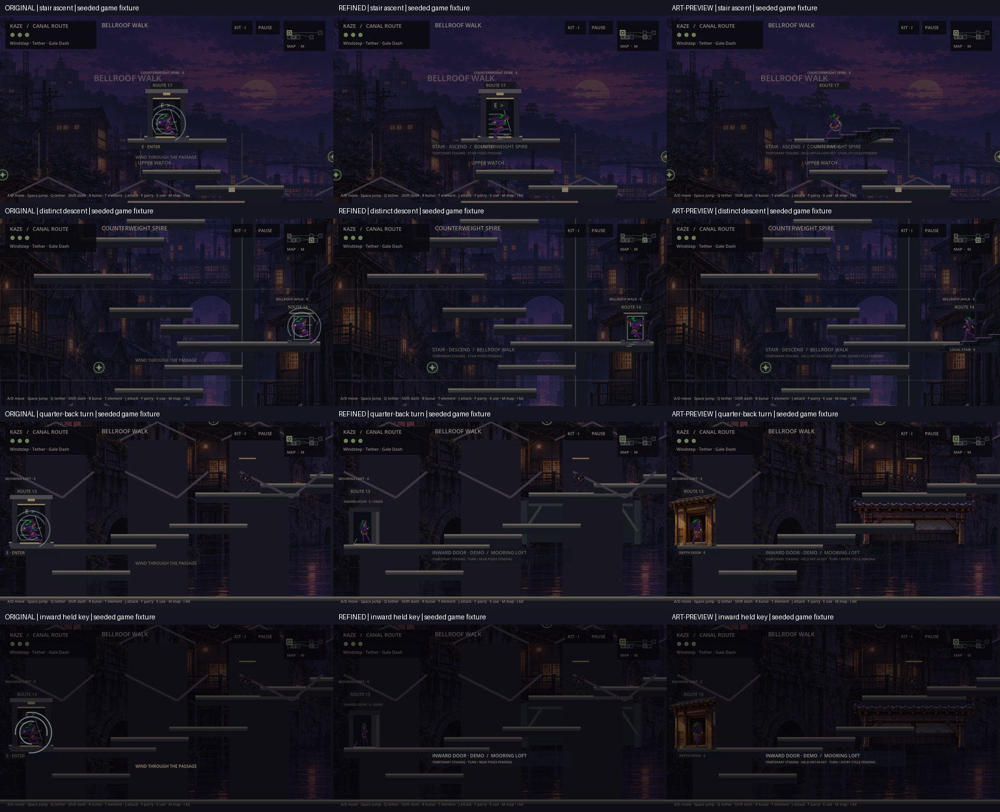
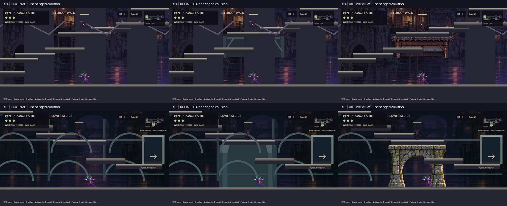

# KAZE — PROJECT MANAGEMENT RETURN REPORT
# INT-TR03 / ART-04 — Production Asset Integration

Date: October15,2026 (America/New_York). Owner: Kaze Integration, Build & QA.

**Integration verdict: READY FOR PM / CREATOR COMPARISON.** Playable local Windows and universal macOS comparisons are delivered. Native Windows/hosted packaging is coordinated with the Build Shogun and is a separate verification gate. No merge, final cycle-art acceptance or production release.

## A. Executive summary

Continued the actual TR03 Lane A implementation from PR27, not the older INT01/TR01 foundation. Selectively imported31 runtime asset/resource/import files from ART04 PR30, preserving original assets and all authoritative simulation code. Added an explicit art-preview option connecting the four supplied held drawings to the existing doorway/stair render adapter. Refined/original/reduced/plain comparisons remain available.

R14/R15 supports replace only the two scoped procedural pilots in art-preview. Bounded drawing suppression resolves overlapping old roofs/arches without altering collision platforms, gates, pickups or unrelated decorations. Door rear/interior and foreground layers now bracket the actor. Stair artwork and foreground lip use the reviewed local registration; R17 is clipped at its room boundary rather than stretched.

Actual source QA:29-action batch,21 behavioral suites plus preservation/profile actions, **1,158 passing checks, zero assertion failures or script/parser errors**. Five CLI modes add21 passes; native game fixtures20/20; macOS packaged launchers45/45. Real packaged E-key R14→R17→R14 interaction passed with visible arrival character. Four keys are explicitly not complete animation cycles.

## B. Inputs, isolation and publication

| Item | Verified identity |
|---|---|
| PR27 / Lane A | `c2c002267c58e991966c0eebf7e098c6e7fff769` |
| PR30 / ART04 delivery | `a6b76b9938825307bdcd4efb687c7198ea0d8681` |
| New implementation | `295ee2d56b991490be52858c25bf8432e91550ba` |
| Pinned runtime/art/build checkpoint | **`e91e49caeada21baad5ab25e5080e67ab16a4094`** |
| First evidence/build handoff | `3efdd2f9312cff37d4843ed109a2cbec417f5d01` |
| Dedicated branch | `integration/int-tr03-art04-production` |
| Draft PR | https://github.com/cappy2yappy/momentum-fractured/pull/31 |
| PR base | `feature/alpha-0.6.1-tr03-embodied-transitions` (PR27) |

Verified PR heads matched the specified assets/current Lane A; no advancement was silently consumed. The ART04 branch is stacked on an art foundation and was **not merged wholesale**. Only `assets/art04/` was imported. The high-resolution/ORA masters remain preserved on PR30; they are not needed in a runtime build.

Separate checkout: `/Users/tonysantiago/.codex/.chatgpt-projects/g-p-6aa9b0443c20819186909618bb6be970/work/int-tr03-art04-live`. An initial local reference-clone attempt could not resolve the Lane A tree; a direct dedicated clone succeeded. Existing art, integration and transition checkouts and synced `sources/` were left intact.

Engine `/Applications/Godot.app/Contents/MacOS/Godot`, official `4.6.1.stable.official.14d19694e`, macOS arm64 / Apple M4 / OpenGL compatibility. Local exports used previously downloaded matching official templates from the ignored INT01 template HOME. No local Windows or Wine runtime was available.

## C. Implementation and preservation

### Character presentation

`art04_presentation.gd` is a render-only resource/registration layer used by `embodied_transitions.gd`.

- `turn_depth_key` then `enter_depth_key` are held during the existing R14→R13 depth demonstration. The two keys do not loop. Production art uses a uniform0.303125 scale and fixed320×724/pivot(160,600)/offset(0,-238); no squeeze-to-fake-turn or runtime alpha-box centering.
- `stair_up_key` is the authored right-up contact for R14→R17. `stair_down_key` is the distinct authored left-down contact for R17→R14. One held contact is shown, not a fabricated three-frame ascent/descent cycle.
- Outward/front-quarter/reorientation and unsupported arrival facings have no supplied art. They use the approved idle texture at its original registration and explicit pending-art labels. Rear art is not silently mirrored into an outward front.
- Existing R15/R16 running still uses the approved run clip; walk remains its inherited labelled placeholder. Exceptional R20/R13 wind-fold policy is unchanged.
- Reduced art-preview holds one pose without staged translation or cycling. Original, existing refined, reduced and plain remain immediately selectable.

### Architecture and drawing order

`room_presentation.gd` draws the new support assets after legacy background drawing and before physical platform lips. Scoped intersection predicates skip only procedural roof/arch elements overlapping the R14/R15 support bounds. `world_expansion.gd` adds one such predicate inside its decorative drawing loop; every other byte of that file is unchanged. Its platforms, one-way geometry, enemy/hazard behavior, portal endpoints, ability requirements and progression remain intact.

Door: interior → rear frame → live actor/proxy → front jamb/threshold → cue. Stair: flight → proxy/contact → front lip → cue. The foreground lives in the render adapter below HUD CanvasLayer. R17's flight is explicitly cropped at x1800 while preserving local width/y-scale; it is not reflected or stretched to fit. The R14 and R17 drawn stairs remain **local render staging over existing flat collision shelves**, not new walkable physical stairs.

### Protected behavior

World, player, mixed-transition policy, HUD, momentum, save/config/input functions, map, export presets and original manifest match PR27 byte for byte where checked. Original approved sheets are unchanged. The TR02 preservation verifier retains32 checks; it permits only the exact one-line decorative suppression addition in `world_expansion.gd`, while verifying all remaining bytes against TR02. The separate ART04 verifier checks all31 imported files against PR30 plus11 protected PR27 files:42 passes.

No speed/jump/floatiness/swing/dash/capsule changes; no graph/gate/save/progression changes. Exact0.65s timing, below0.32s/tick20 swap, reciprocal arrival and current freeze/carry semantics remain authoritative. Pause/death/rebuild/denial restore the real visible sprite and clear the held-key state. No effect or pose moves the simulation body.

## D. Acceptance matrix

| Requirement | Status | Evidence / boundary |
|---|---|---|
| Continue current PR27 | PASS | Dedicated branch based exactly on c2c0022; no old foundation replacement |
| Import four keys/door/stair/supports | PASS |31 pinned runtime files;42 provenance/preservation checks |
| Resolve roof/arch overdraw | PASS (scoped) | Native R14/R15 before/refined/art-preview screenshots; bounded suppression only |
| Bind doorway/stair transitions | PASS (held keys) |111 new transition assertions;20 native rendered fixtures |
| Keep original timing and gameplay | PASS | Exact protected bytes, tick20/39–40 tests,21 behavioral suites |
| Keep collision/progression/saves | PASS (bounded) | Collider arrays/counts, gate tests, legacy/malformed/current saves and separate-process reload |
| Original/refined/art/reduced/plain | PASS | Five CLI profiles21 checks;45 packaged Mac launchers |
| In-engine alignment and cleanup | PASS (scoped) |126 native captures; up/down contact errors1.297/0.164px; R17 arrival/fallback review |
| Performance measurements | PASS (bounded measurement) |12 native unpaced draw samples plus50 packaged FPS samples; no full-campaign certification |
| Playable comparison builds | PASS locally | Windows export/CRC/PCK audit; Mac45 boots + native E-key round trip |
| Native Windows startup / hosted artifacts | PENDING BUILD SHOGUN | Handoff dispatched after integration passed; final publication result recorded below |
| Full motion cycles / human acceptance | NOT COMPLETE / PENDING | Four keys only; creator art/feel and full campaign approval remain open |
| No merge | PASS | Draft PR31 only; PR27/PR30/main/shared integration not changed by this work |

## E. Automated QA and reproduction

Final source batch comprises29 recorded actions: warmup/settled imports, baseline verifier,32-check preservation verifier,42-check asset verifier,21 behavioral suites, two separate-process profile stages and58-directed-endpoint audit. **1,158 executed PASS lines,0 FAIL lines,0 script/parser/load errors**; all actions exit0. Counts include overlapping coverage and actual executed preservation checks; historical totals are not added. Endpoint classification is printed as58 entries, not inflated into assertions.

| Behavioral suite | PASS checks |
|---|---:|
| approved_baseline |32|
| approved_combat_swing |7|
| annex_expansion |34|
| annex_traversal |6|
| save_compatibility |11|
| skyworks_progression |33|
| storm_keeper |12|
| movement_momentum |53|
| sprite_integration |43|
| world_expansion |193|
| expansion_gates_save |17|
| expansion_traversal |125|
| gameplay_stabilization |16|
| traversal_transitions |8|
| world_cohesion_traversal |56|
| integration_candidate |12|
| integration_descent |26|
| room_transition_prototype |93|
| mixed_transitions |109|
| embodied_transitions |80|
| art04_transitions |111|
| **Behavioral total** |**1,077**|
| Separate-process prepare/reload |7|
| TR02 preservation / ART04 provenance |32 /42|
| **Batch total** |**1,158**|

Additional separately recorded checks: CLI original/refined/art-preview/reduced/plain21 passes; native transition fixtures20 passes; packaged Mac launcher processes45 passes. These are not silently added to the source-batch total.

Reproduce:

```sh
python3 tools/run_int_tr03_art04_qa.py --godot /Applications/Godot.app/Contents/MacOS/Godot
```

Exact command arrays, profiles, durations, return codes, counts and diagnostics: `docs/int_tr03_art04/evidence/REGRESSION_RESULTS.json`; raw suite output in `evidence/qa`. macOS uses disposable HOME as well as explicit test saves/XDG/APPDATA. The existing Lane A runner only configured Linux/Windows environment paths; the new runner adds macOS HOME isolation. The final runner also chooses a new nonce-named restart profile on each invocation; a separate7-check process replay confirmed repeatable fresh prepare/reload. No creator saves were read/deleted. CLI path-with-spaces commands/results and native/packaged logs are committed separately.

Warnings:26 batch processes emitted isolated-HOME macOS certificate errors. Both editor imports emitted CanvasItem/ObjectDB and dummy-texture/font/shaped-text RID shutdown diagnostics. They are preserved and not described as a warning-free run. They caused no assertion or script/parser failure.

The first native capture harness reported20 exact-arrival failures because it let the player's resumed physics settle under gravity before comparing the exact arrival. Freeze-at-completion corrected the fixture; final20/20 pass, without a gameplay change. Both attempt logs are kept. Earlier diagnostic/local-clone failure did not alter source history or acceptance.

## F. Native visuals, alignment and performance

Native source fixtures:1280×720, camera zoom1, real game scenes/gates/loader, seeded abilities and manual60Hz loader stepping.20 transitions (four directions ×five comparisons) produce120 screenshots; six structural views bring total to126. Screenshots are scripted evidence, not a human earned campaign.

- R14 collider count23 across original/refined/art-preview; R15 count15. Full arrays/gates are also compared in automated tests.
- Leading-boot contact is checked against the authored flight's opaque tread at native scale: ascent1.297px error, distinct descent0.164px. Registration remains fixed. This measures two held contacts, not animated foot sliding across absent cycles.
- Inspected new doorway back/front split and inward pose, stairs in both rooms, R17 boundary/arrival, restored actual character, original/refined/art/reduced/plain views, support layering and HUD/cue readability. Existing physical platforms can still occlude dressing because they are preserved geometry; procedural overdraw at the two supports is removed.




Native unpaced render intervals:30 warmup +120 measured samples for each of four modes in R14/R15/R17, no screenshot encoding inside timing. This is native draw-loop wall time/throughput, not GPU-only execution, display refresh, live combat load or sustained campaign FPS.

| Room | Original mean/p95 ms | Refined mean/p95 ms | Art-preview mean/p95 ms | Reduced mean/p95 ms |
|---|---|---|---|---|
| R14 |1.239 /1.385|1.189 /1.312|1.249 /1.821|1.909 /2.243|
| R15 |1.229 /1.287|1.260 /1.294|1.209 /1.282|1.227 /1.301|
| R17 |1.250 /1.278|1.237 /1.307|1.243 /1.280|1.239 /1.283|

Exact maxima and draw-call counts: `evidence/PERFORMANCE.json`. These small samples do not establish a speedup. The separately packaged interactive game produced50 one-second FPS samples, **112–121 FPS**, mostly120, including pause/focus and the keyboard stair round trip. `evidence/mac_interactive.txt` records them. No full-route/combat/per-platform60FPS acceptance is claimed.

## G. Playable local packages

Both exports use matching official Godot4.6.1 release templates. **Build source is e91e49caeada21baad5ab25e5080e67ab16a4094**; later report/evidence commits do not alter runtime or assets. Existing binary product strings remain preserved; filenames/README/source manifest identify INT-TR03 ART04.

| Local archive | Bytes | SHA-256 |
|---|---:|---|
| Kaze-INT-TR03-ART04-Windows.zip |52,121,874|`5d751ee05fa92c5247e7fb668a64b5a3044f584b6b8b4bb80eb854f7d4912f48`|
| Kaze-INT-TR03-ART04-macOS-Universal.zip |76,904,820|`ca5af774b8bf33d7ae432fbcb609338eec7a57419164e2b09eb133bb6965327f`|

Validated local prefix: `/Users/tonysantiago/.codex/.chatgpt-projects/g-p-6aa9b0443c20819186909618bb6be970/work/int-tr03-art04-live/build/int-tr03/packages/`. These local files are not claimed as GitHub uploads. Per-platform/source/binary hashes, CRC results, Mac PCK hash and resource counts are committed in `evidence/*BUILD_MANIFEST.json` and `MAC_PACK_COMPONENT.json`.

- ZIP CRC passes. Both PCK audits report567 entries, no build/test/doc/tool/source_art entries, and actual ART04 resource presence. No personal or seeded save profiles are embedded; fixtures are generated by launchers on first use.
- Nine pilots ×five modes =45 launchers per platform. Mac45/45 run `--headless --quit-after12` successfully from `Launcher QA With Spaces`; explicit save/profile paths remain isolated. Actual native Mac packaged startup passes.
- Real packaged keyboard check: Escape resumes inherited pause overlay; E moves Bellroof Walk→Counterweight Spire; E returns to Bellroof Walk; character visible after both. UI screenshots are inline in the integration chat; `MAC_PACKAGED_UI_CHECK.md` records observation/boundaries.
- Windows PE x86_64, embedded PCK, export/CRC/resource checks pass. **Native Windows/PowerShell execution is not available locally**; Build Shogun owns that follow-up. Intel macOS remains untested. Mac is unsigned/not notarized.

Exports and packages are reproducible with existing presets plus `tools/package_int_tr03_art04.py`. Exact export/packaging logs are retained. Do not use inherited `package_tr03.py`, whose hardcoded historical source IDs describe the old Lane A package.

## H. Build Shogun coordination

After integration passed, attempted delivery to the newer **Build Shogun Recovery** chat; its desktop executor was disconnected. Dispatched the same source-pinned handoff to the existing local **Build Shotgun** specialist chat (`01a13be3-5f23-77f1-a030-5ece454d0071`), which acknowledged recovery of BUILD03 and is adapting its existing workflow for45 launchers/platform, paths with spaces and bounded native Windows boot checks. No new chat was created.

Handoff: `INT_TR03_ART04_BUILD_HANDOFF.md`. Build owner was told to use a separate checkout, preserve my integration tree, reuse BUILD03/CI02, retain all modes, report native versus cross-export evidence, publish hashes/source/run/artifact/expiration links and never merge. Local Mac results were sent as supplemental evidence. Windows launcher smoke options belong on the build branch, not a gameplay rewrite.

Hosted/native Build Shogun completion is recorded in a subsequent publication note when available. Local comparison delivery does not depend on claiming its unfinished work as complete.

## I. Creator playtest instructions

1. Extract the desired ZIP to a writable folder. Begin with **Play-stair-up-art-preview**, then refined and original; use `.command` on Mac or `.cmd` on Windows. Each mode has a separate persistent isolated profile and an explicit absolute save filename.
2. Press E at the local stair; inspect the held upward key, R17 arrival/restored sprite, then E back with the separate downward key. Compare reduced and plain. The visible flight is local render staging over the preserved collision shelf.
3. Try **Play-depth-art-preview** and **Play-reverse-depth-art-preview**. Inspect authored turn→inward keys and foreground jamb; outward/reorientation/arrival art is expressly missing and uses labelled fallback.
4. Compare structure14/structure15 original/refined/art-preview for roofs/arches/material brightness, HUD/gate/pickup visibility and load-bearing contacts. Test ordinary falls/returns and doorway activation without assuming new physical stairs.
5. Passage: wait one second, holdD to walk or double-tapD to run R15→R16; compare existing run feel. Special: E on the exceptional wind-fold. Physics and input mappings remain inherited. Gamepad acceptance remains open.
6. Targeted launchers seed abilities once as QA fixtures. **Play-fresh-art-preview** starts unseeded Haven. A direct EXE/.app launch uses the historical normal save identity; back it up before deliberate existing-save testing. Do not delete creator saves. Optional momentum is not enabled by default.
7. Return room/direction/mode, timing/contact/occlusion observations and pose identity feedback with the source/build hash. Do not assess these four keys as complete cycles.

## J. Risks, PM decisions and next ownership

Open gates: creator art/identity/material/feel approval; missing walk/outward/front-quarter/opposite-facing and remaining cycle drawings; full earned campaign/max-speed/rope/softlock review; gamepad input/hardware; native Windows/Intel launch; signed/notarized Mac distribution; sustained live/combat performance. Source suites and scoped captures do not replace those checks.

PM should review draft PR31 and the five comparisons, then decide focused art corrections/next-cycle production. Build Shogun completes platform/hosted verification and supplies downloadable artifacts/expiration evidence. Existing PR27 and PR30 stay open/unmerged; this request does not approve their mainline acceptance or global structural rollout.

## K. Final verdict

**READY FOR PM / CREATOR COMPARISON — scoped production-asset integration complete, playable local builds delivered, hosted/native Windows verification delegated to Build Shogun.** Four authored keys remain held-key staging, not finished animation cycles. **DO NOT MERGE.**
