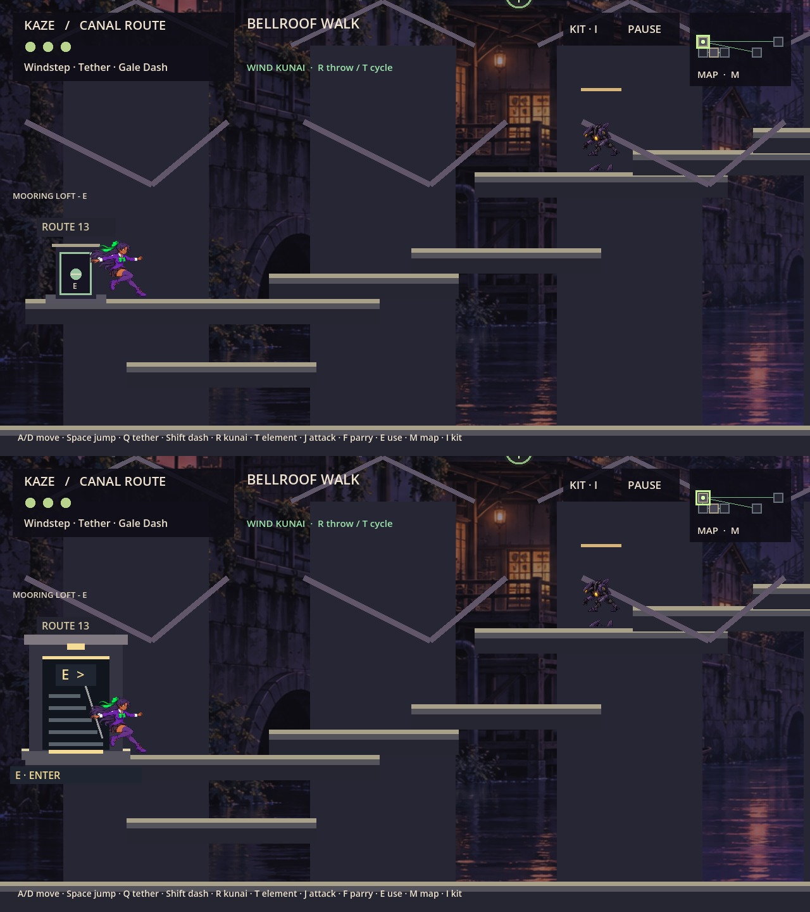
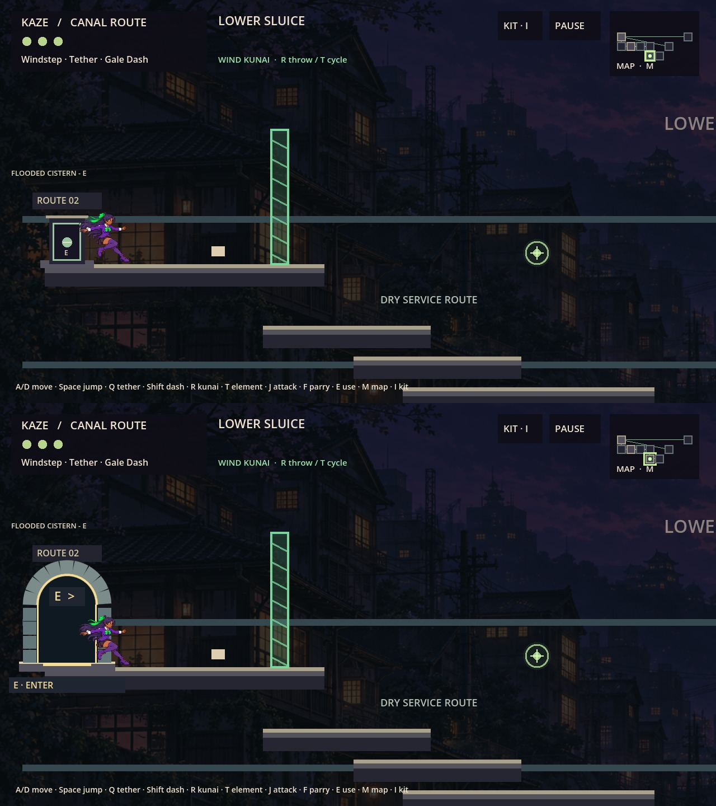
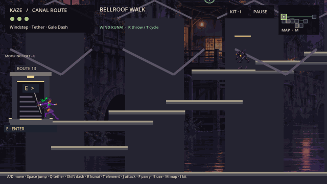

# KAZE — PROJECT MANAGEMENT RETURN REPORT

**TR-01-0061 — Room Transition Prototype**  
**Date:** October 14, 2026 (America/New_York)  
**Verdict:** READY FOR PM REVIEW — prototype review, not release or merge approval.

## A. Executive Summary

Implemented two contextual entrance treatments on the combined Alpha 0.6.1 foundation: a lit rooftop service stairwell in R14 Bellroof Walk and a segmented masonry tunnel in R15 Lower Sluice. All five existing exits in those two rooms use larger architecture, readable E/proximity cues and prerequisite-driven locked feedback. A concise ninja wind-fold accents transitions involving pilot rooms; a stationary reduced-motion alternative is available. Other room entrances retain the prior compact housing.

Godot 4.6.1 import and preservation verification pass. The full combined runner produced 691 passing assertions; the dedicated transition regression produced 109, totaling **800 PASS / 0 FAIL**, with no final-run script errors. Native normal-zoom evidence and an Apple-M4-tested macOS universal playable package were produced. Source and evidence are pushed in draft PR #12. Nothing was merged.

## B. Source/Branch Verification

The complete [work order](https://github.com/cappy2yappy/momentum-fractured/blob/c1e233d6831842b45f30239d6321799368d6fe9f/docs/agent_assignments/TR01_ALPHA061_ROOM_TRANSITION_PROTOTYPE.md) was retrieved through connected GitHub access and read before editing. Its authoritative branch `docs/pm-tr01-alpha-0.6.1-room-transitions` was fetched at `c1e233d6831842b45f30239d6321799368d6fe9f`.

The source branch `integration/candidate-alpha-0.6.1-gp-ld` was fetched and verified at `afecef1922231081807a332c511de85c7941fec8`, matching the assignment's observed head and [combined PR #10](https://github.com/cappy2yappy/momentum-fractured/pull/10). A clean, separate worktree was created at:

`/Users/tonysantiago/.codex/.chatgpt-projects/g-p-6aa9b0443c20819186909618bb6be970/work/tr01-alpha061`

Assigned development branch: `feature/alpha-0.6.1-room-transition-prototype`. Runtime/source/evidence implementation commit: [`6867d19d4f1d8edbf104e04726d5b07741cf9fc4`](https://github.com/cappy2yappy/momentum-fractured/commit/6867d19d4f1d8edbf104e04726d5b07741cf9fc4). This report and final package provenance are included by a subsequent documentation/publication commit; its exact committed report permalink is returned in the originating chat. Existing working trees and specialist branches were preserved.

## C. Existing Transition Audit and Problem

Reviewed canonical baseline, repository guide, LD-01 report/PR #9 evidence, PM creator decisions and all three PR #10 atlases containing 54 captured exits. LD comparison images used zoom 0.65; combined atlases and this assignment's fresh images use 1280×720 and zoom 1.0.

Existing `world.draw_door()` delegates to `RoomPresentation.draw_exit()`, shared by original, extension and expansion exits. The existing housing is 64×84, inset 48×65, base 96×14 and E text 12px. It reads smaller than Kaze and lacks environmental purpose at ordinary camera scale. A global substitution would affect every exit family, so the implementation uses a bounded room style map.

E invokes existing checkpoint/expansion/extension/original interaction priority. Original chain radius is strictly <105 pixels; expansion radius is strictly <85; extension returns keep their own checks. Existing `request_room()` enforces prerequisites, freezes physics for the 0.65-second transition, changes room below 0.32 seconds, uses unchanged reciprocal arrival coordinates, clears velocity and restores physics when finished. Respawn clears pending transition state. These functions, save serialization and camera/player code remain unchanged.

## D. Two Proposed Treatments + Prototype Room IDs

| Room | Treatment | Existing destinations | Prerequisites retained |
|---|---|---|---|
| R14 Bellroof Walk | Solid service stairwell, recessed steps/handrail, roof cap and warm lamp | R13, R9, R17 | Windstep; Relay restored; Tether + Dash |
| R15 Lower Sluice | Dark tunnel recess, segmented masonry arch, side stones and warm threshold | R2, R16 | Wind Kunai + opened Cistern cache; Relay restored |

The rooms are in the existing connected graph; **no direct R14–R15 edge is added**. Selection uses existing roof/canal presentation, supported arrivals and tested conventional routes. No unmerged Art PR #11 dependencies or new Ruins canon are introduced.

Visual alternatives: (1) navigable contextual architecture plus stationary signature with `--tr01-reduced-motion`; (2) the same architecture plus three lightweight wind arcs during the existing fade. Warm E/arrow cues distinguish entrance activation from elemental seals. Nearby unlocked exits say **E · ENTER**; outside ordinary range they say **APPROACH**; locked exits show a padlock and current prerequisite. Route plaques and target labels move above the taller facade only in the pilot rooms.

## E. Actual Implementation and Files

- `scripts/room_presentation.gd`: bounded `{14: rooftop, 15: masonry}` styles, matching existing portal data, procedural architecture, gate/proximity cues, preserved legacy drawing body and clock-derived wind-fold/stationary accents.
- `scripts/hud.gd`: delegates the pilot transition accent; unrelated transitions retain their prior outline and fade.
- `scripts/world_expansion.gd`: only pilot destination-label placement changed; all code before `draw_room()` is byte-identical.
- `tests/room_transition_prototype.gd`: 109 assertions covering pilot/return routes, gates, range, actual E, held/repeated E, exact arrivals, supported landings, geometry, death/reset, save/reload and original exits.
- `tests/capture_room_transition_prototype.gd`: native capture/performance harness and real transition-frame capture.
- `tools/run_tr01_qa.py`: combined plus dedicated reproduction with disposable profiles; optional native captures.
- `tools/package_tr01.py`: wraps a macOS export with isolated fresh/seeded launchers and manifest.
- [Specification](../level_design/alpha061/ROOM_TRANSITION_PROTOTYPE_SPEC.md), [structured results](TR01_ALPHA061_TEST_RESULTS.json), [evidence directory](tr01_evidence/), and this report.

All new artwork is original procedural placeholder geometry. Existing neutral backgrounds/art are reused unchanged. No AI image generation or external asset import was required.

## F. Preservation and Gameplay Compatibility

`verify_baseline.py` passes. Direct byte comparisons against the foundation confirm **51 audited files unchanged**, including `player.gd`, `world.gd`, momentum, grapple, original and cleaned character art, project configuration and map data. [Hash audit](tr01_evidence/preservation_audit.json) records the comparison.

Speed, jump floatiness, dash impulse/timing, tether momentum, sprite dimensions/anchors, combat/kunai logic, all 21 rooms, connectivity, reciprocal arrivals, platform/collision geometry, physical gates, ability requirements, lore, encounters, checkpoints, application/save identity and version-8 profiles are preserved. No controller checksum change is needed.

The effect introduces no player modulation, new invulnerability, input lock, independent timer or saved state. It follows the existing transition clock and current room IDs, so death/entry cannot leave a separate effect behind. Gates remain enforced in both directions. Actual E input and held E are tested; holding the key does not bounce back after completion. Save/load round-trip and separate-process compatibility checks pass.

## G. QA Evidence / Measured Performance / Preview or Builds

Engine: `4.6.1.stable.official.14d19694e`; macOS on Apple M4. Tests used workspace-local disposable user data. No creator profiles were deleted or overwritten.

| Suite | PASS | FAIL |
|---|---:|---:|
| approved_baseline | 32 | 0 |
| approved_combat_swing | 7 | 0 |
| annex_expansion | 34 | 0 |
| annex_traversal | 6 | 0 |
| save_compatibility | 11 | 0 |
| skyworks_progression | 33 | 0 |
| storm_keeper | 12 | 0 |
| movement_momentum | 53 | 0 |
| sprite_integration | 43 | 0 |
| world_expansion | 193 | 0 |
| expansion_gates_save | 17 | 0 |
| expansion_traversal | 125 | 0 |
| gameplay_stabilization | 16 | 0 |
| traversal_transitions | 8 | 0 |
| world_cohesion_traversal | 56 | 0 |
| integration_candidate | 12 | 0 |
| integration_descent | 26 | 0 |
| separate-process profile prepare/reload | 7 | 0 |
| room_transition_prototype | 109 | 0 |
| **Total** | **800** | **0** |

Import, baseline verifier and all final behavioral tests exit 0. Commands from the feature worktree:

```sh
python3 tools/run_tr01_qa.py
python3 tools/run_tr01_qa.py --render
python3 tools/verify_baseline.py
```

The actual initial full execution used `python3 tools/run_int01_qa.py`, followed by the dedicated test under a separate disposable profile. Raw commands, isolated profile paths, counts, return codes and warnings are retained in `tr01_evidence/combined_results.json` and per-suite logs. Native baseline captures were made before the runtime edits. The committed capture harness was then used on the completed prototype; `--before` can reproduce baseline labels when run against the baseline checkout with that capture helper.

Five native before/after endpoint pairs show unchanged Kaze size at 1280×720 zoom 1.0; both locked states and effect alternatives are included. Compact comparison images stack baseline above prototype:





The GIF captures actual transition code advanced at one 60Hz tick per rendered frame, sampled every three frames at 50ms. It is a seeded visualization, not a human campaign recording.

Native OpenGL/Apple M4 short effect-frame samples, 30 warm-up frames followed by 120 measured frame intervals; screenshot writes occur during warm-up, outside timed samples:

| Mode / room | Mean ms | p95 ms | Max ms |
|---|---:|---:|---:|
| Wind-fold / R14 | 8.335 | 9.316 | 11.001 |
| Wind-fold / R15 | 10.432 | 13.603 | 32.610 |
| Reduced / R14 | 8.338 | 9.181 | 10.022 |
| Reduced / R15 | 8.333 | 9.134 | 10.469 |

These are short isolated overlay/render samples, not sustained 60 FPS certification. R15's 32.610ms maximum demonstrates a missed 16.67ms frame budget. They do not measure a full campaign, integrated room-build hitch or lower-end hardware.

**Playable package:**

`/Users/tonysantiago/.codex/.chatgpt-projects/g-p-6aa9b0443c20819186909618bb6be970/work/tr01-alpha061/build/tr01/Kaze-TR01-Alpha061-macOS-Universal.zip`

ZIP size 75,951,003 bytes; SHA-256 `bf5eec82d807548a510cef208d6fb3e6909c5756f5afc56ae4b8e370dab3103b`; ZIP CRC passes. [Build manifest](tr01_evidence/BUILD_MANIFEST.json) records runtime source SHA and changed-script hashes. Runtime is exported from implementation commit `6867d19d4f1d8edbf104e04726d5b07741cf9fc4`; publication follow-up does not alter runtime scripts. Native and headless boots pass for both pilot fixture profiles. The exported PCK passes a Godot editor-engine audit with zero forbidden docs/tests/tools/build entries, correct R14 style and functional R14→R13 transition. Apple Silicon execution tested; Intel untested; Windows not exported. Package is unsigned and not notarized. **No remote binary publication is claimed.**

Nonfatal diagnostics: macOS certificate-store retrieval error in headless runs and import/export MetSys/engine RID, font/texture and ObjectDB cleanup warnings. Logs preserve them. The first native attempt inside the sandbox aborted before rendering; approved native execution succeeded. Initial dedicated-test harness collided with Godot's built-in `seed()` name and was corrected to `seed_progress()`. A synthetic E check initially ran outside a physics frame; the final test uses actual input and awaited physics ticks. The release executable did not execute an external inspection script and was stopped; the exported PCK audit then passed using the editor engine. Final tests contain no script errors or failing assertions.

## H. GitHub Publication

- [Feature branch](https://github.com/cappy2yappy/momentum-fractured/tree/feature/alpha-0.6.1-room-transition-prototype).
- [Runtime implementation commit](https://github.com/cappy2yappy/momentum-fractured/commit/6867d19d4f1d8edbf104e04726d5b07741cf9fc4).
- [Draft review PR #12](https://github.com/cappy2yappy/momentum-fractured/pull/12), targeting `integration/candidate-alpha-0.6.1-gp-ld` at `afecef1922231081807a332c511de85c7941fec8`.
- Push succeeded and remote feature SHA matched local implementation SHA. The final report/provenance follow-up is pushed on the same branch and returned with an exact committed report permalink.
- No merge, force push, rebase, history rewrite, shared integration mutation or main mutation performed. PRs #8–#11 remain untouched.

## I. Risks / Unresolved Questions

Human approval of scale, silhouette/readability and wind-fold feel remains required. Art is placeholder geometry. Visual facades are larger than the preserved 85px activation radius; assess whether APPROACH/E feedback makes this clear. Only pilot room entrances change; reciprocal neighboring architecture remains legacy intentionally. The reduced-motion option removes angular strokes but keeps the inherited fade and is a launch option, not a saved settings menu. Native launchers require Python 3. Short frame samples, seeded landing tests and smoke boots do not establish a full unseeded campaign, exhaustive physical sequence-break resistance, sustained 60 FPS or Intel/Windows compatibility.

No blocking implementation/permission issue remains. Do not migrate this treatment globally before creator approval.

## J. Creator Playtest Steps and PM Decisions Required

1. Unzip the local macOS package. Use **Play Rooftop.command** or **Play Canal.command**, which maintain separate `playtest-profile-rooftop` / `playtest-profile-canal` folders beside the package. These fixtures explicitly seed relevant abilities/route progress; they do not represent earned progression. **Play Fresh.command** uses another isolated campaign. No personal saves ship in the archive. Opening the app directly uses the normal app save identity; use the supplied launchers for this review.
2. R14 starts by the west service entrance at (120,1100). Press E to R13; release E and press again to return. Walk the roof route to the east entrance (2440,830) for R9, then return. Use the existing upper route to (1450,480) for R17, then return. Assess entrance scale, roof integration, E readability and contrast with grapple/elemental artwork.
3. R15 starts by the upper-west masonry entrance at (120,500). E goes to R2 and back after release/repress. Descend the existing dry ledges to (2080,1120), E to R16 and return. The green Wind seal at (500,500) remains a separate physical gate. Check that the warm tunnel does not imply a new element requirement.
4. Approach from outside 85 pixels and confirm APPROACH becomes E · ENTER only inside ordinary range. Press or hold E repeatedly during a transition; check no restart/bounce, visibility restored and movement resumes. Miss a shelf or die and verify checkpoint recovery; save at an existing shrine, quit and relaunch the same fixture launcher to verify persistence.
5. Compare **Play Rooftop Reduced Motion.command** / **Play Canal Reduced Motion.command** with normal wind-fold. A/D move, Space jump, Q tether, Shift dash, E interact, R kunai, T element, M map, I kit, Escape pause. Report room/exit, approach side, gate state and any obscured cue or stuck input.
6. PM/creator choose whether to approve either treatment's scale, architecture and motion; decide whether reduced motion needs a saved menu option; assign production Art and longer performance/platform testing if advancing. Any all-room rollout and integration merge require a separate explicit decision.

## K. Verdict

**READY FOR PM REVIEW.** Two bounded contextual prototypes, preservation/gate/save regressions, visual evidence, measured limitations, a local playable macOS candidate and draft GitHub review are delivered. Creator/PM acceptance and any integration remain pending.
