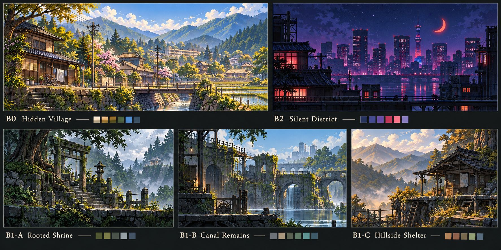
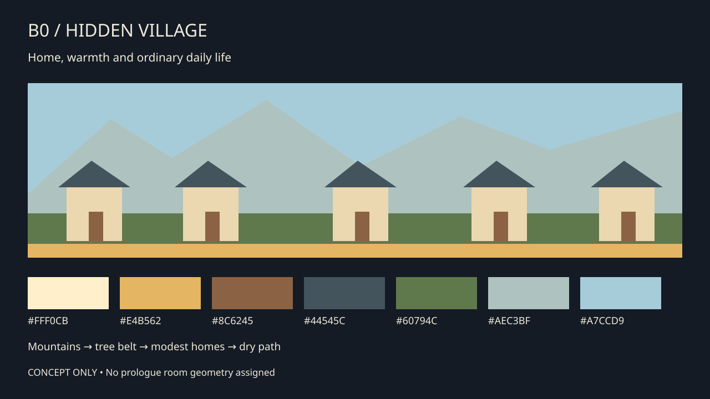
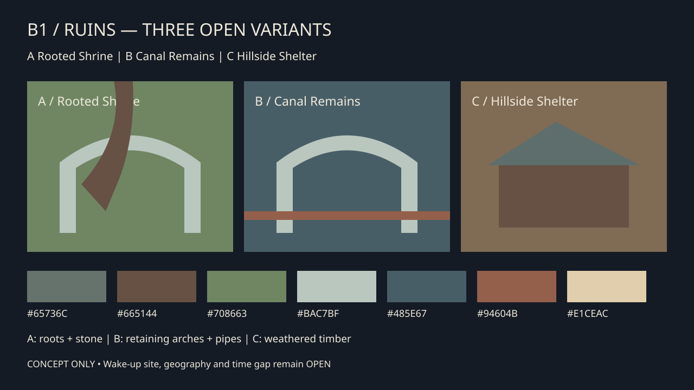
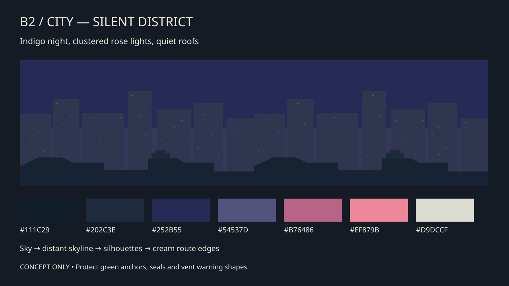

# ART-01-0061 — Early biome visual bible

**Status: CONCEPT ONLY / creator review required.** Village and city reference direction is creator supplied; the palettes, landmarks and modules below are original proposals. No gameplay or geometry is changed. Ruins variants are equally provisional. [Implementation spec](IMPLEMENTATION_SPEC.md) · [Asset matrix](ENVIRONMENT_ASSET_MATRIX.md) · [Preview index](previews/README.md).

## Original concept board

AI-generated mood exploration, distinct from the editable composition prototypes. Its red crescent, civic tower and shrine details are illustrative and remain unapproved; the technical production proposal omits the red crescent.

## Reference reading

Both originals were retrieved byte-for-byte from commit `7312c62068e8b964ce78848b85024b876af6efc3` and visually inspected. Their hashes match the source values in registry commit `e43ab287265764bdb011362198ecff612a633c66`.

- City: indigo/violet sky, charcoal towers, scattered vivid pink-red windows, a bright crescent, tower landmark, water reflections and dark foliage framing. Translate contrast and light clustering into side-view roof navigation. The red crescent is a reference motif, **not established story canon**; omit it from the first production module. Do not copy the tower silhouette or window arrangement.
- Village: warm low-angle sunlight, pale blue layered mountain haze, green fields, a canal, vernacular tile roofs alongside modern everyday buildings, fences, utility wires and domestic roads. Translate lived-in scale and warmth into lateral routes. Its oblique aerial perspective is mood evidence, not a collision layout.
- Unknown third-party reference rights: reference originals are inspiration only, never production textures. No reference pixels are incorporated into the authored SVG prototypes.

## B0 — Hidden Village / Prologue: “A place worth returning to”

**Emotional goal:** familiar daily life, shelter and relationships before danger. The hidden clan home should feel socially active, not an empty museum or medieval fantasy settlement. Kaze's confirmed age is 16; a school-side path may be an environmental motif, without scripting her routine here.

**Palette:** warm cream `#FFF0CB`, sun gold `#E4B562`, earth `#8C6245`, slate roof `#44545C`, foliage `#60794C`, mountain haze `#AEC3BF`, sky `#A7CCD9`. Use warm light against cool roofs; reserve saturated yellow-green for bounded vegetation clusters, leaving Kaze's green accents readable.

**Architecture / time / weather:** modest plaster-and-timber homes with low tile roofs, small school/community building, fenced plots, store shutters, contemporary poles and bicycles; late-afternoon golden daylight with dry clear air. Daylight is a proposed visual treatment, not the canon hour of attack.

**Landmarks:** paired ridge cedars, a modest community bell shelter, irrigation footbridge. Repeat a restrained braided-rope or painted wood join motif; do not assume supernatural clan emblems are approved.

**Depth:** distant blue mountain silhouettes; muted tree belt; housing grouped beneath the skyline; sparse fence/grass in the near layer. Keep the middle traversal band spacious but inhabited through peripheral laundry, buckets, firewood, shoes and school notices. Do not bake collision platforms into distant roofs.

**Surface language:** light stone path tops, dark supporting stone, readable wooden crossbars. Traversable edges have a continuous thin light band; decorative fences are interrupted/soft-edged to avoid suggesting jumpable collision. Background water is reflective scenery, not implicitly safe/swimmable.

**Contrast / parallax:** cream edges on slate supports; interactive objects add a unique shape and outline, not merely a hue. Proposed far/mountain/mid/near scroll scales 0.08/0.20/0.40/0.70. Leave the character neighborhood free of high-frequency green leaves. Optional tension appears as one still weather vane or a shuttered path only after Story review, not smoke or corpses.

**Reusable inventory / motion:** mountain strip, tree clusters, three roof/plaster house chunks, path supports, bridge rail, rice-plot band, laundry rack, school notice board, bicycle, domestic buckets. Two-frame laundry/leaf movement at 3–4 FPS and slow water sheen are optional; no actor sprites or NPC behavior are implemented.

## B1 — Ruins / Transition: three alternatives

**Shared goal:** a quieter, uncertain threshold between warmth and urban cold, with evidence of previous human care. Never imply a selected escape route, time gap, memory loss, village ruin location or Kaze wake-up site. No original ruins reference was supplied.

| Variant | Visual identity / palette | Landmark and props | Depth / reusable inventory / motion | Story approval boundary |
| --- | --- | --- | --- | --- |
| A Rooted Shrine | Cold diffuse stone `#65736C`, root brown `#665144`, moss `#708663`, haze `#BAC7BF`, pale edge `#E5DCC6` | Split retaining arch, roots wrapping stone joints, tended lamp shelf, repaired cord | Far pale forest, mid arches, sparse near roots; stone blocks, arch crown, two root clusters, lamp housing; slow leaf drift only | May be an old regional shrine; do not label it Kaze's ruined village or wake-up place |
| B Canal Remains | Wet gray-blue `#485E67`, brick `#68554D`, reed `#7B8563`, rust `#94604B`, edge `#C8D8D6` | Sluice aperture, old inspection steps, survey board, dry service pipe | Far culvert haze, mid retaining arches, foreground reeds below routes; arch/wall/pipe/canal modules; limited drip animation | Best technical bridge to existing R15/R16 art motifs; geographic connection remains unapproved |
| C Hillside Shelter | Warm weathered timber `#806B54`, subdued roof `#5E6E6D`, cool haze `#A5B7B6`, muted leaf `#6F7D5D`, edge `#E1CEAC` | Leaning waystation, stone mile marker, empty water bucket, repaired handrail | Far mountain silhouettes, mid timber shell, foreground leaf clusters; support posts/roof/stone steps; optional cloth flutter | A former roadside shelter only; no implied duration of abandonment or escape event |

**Architecture / lighting:** A uses shrine-adjacent stonework without inventing religious symbols; B uses civil water infrastructure; C uses modest rural timber. All use overcast or late-day diffuse light, leaving attack reds and seal colors unambiguous.

**Layer separation:** roots never cross the solid route lip or obscure anchors. Bright shafts of sky stop before active interaction zones. Use broken silhouettes in the far layer; retain continuous clean platform surfaces in the gameplay plane. Parallax proposal 0.08/0.18/0.35/0.65. A faint lamp is environmental evidence, not an interactable unless engineering assigns that role.

**Recommendation:** develop B's infrastructure vocabulary for the *existing Lower Sluice art prototype*, while retaining A/B/C as unresolved choices for a future narrative transition. This does not classify R15 as the prologue.

## B2 — City / Silent District: “Ordinary infrastructure under an unfamiliar sky”

**Emotional goal:** mystery and loneliness while sustaining momentum and readable routes. The city is a modern Japanese-inspired environment; avoid treating every room as neon cyberpunk or assuming ArcuTech owns it.

**Palette:** charcoal `#111C29`, roof ink `#202C3E`, night indigo `#252B55`, atmospheric violet `#54537D`, muted window rose `#B76486`, rare luminous pink `#EF879B`, route cream `#D9DCCF`. Saturated city lights remain distant/clustered; the route plane uses calmer warmer edges. No emission/bloom requirement.

**Architecture / weather:** mixed tile rooftops, water tanks, aerials, compact maintenance buildings, civic/industrial towers. Cool still night, restrained haze; wet reflections may appear below roof routes, not across the character silhouette.

**Landmarks:** an original three-part civic mast, staggered water tanks, a bell-roof shelter and service catwalk brackets. Bellroof Walk can gain its name through an identifiable small bell shelter rather than a huge background pagoda. Counterweight Spire uses vertical rails and paired counterweight bays. Coil Service Hall uses insulated coils and numbered service bays, never glowing seals masquerading as décor.

**Depth / layer separation:** sparse high sky; soft far towers; low-contrast mid roofs; dry roof lips and maintenance supports on the active plane. Main light clusters sit away from grapple anchors, seals and exits. Water repeats broad blurred value bands, not a sharp mirrored duplicate of every window.

**Surface / readability:** actual traversable lips are continuous cream/slate edges with dark support beneath; background roofs have lower contrast and no matching horizontal highlight. Portal housings remain the LD treatment, not painted false doors. Keep existing wind/fire/electric color meanings and green grapple targets; proposed lights cannot override gameplay colors.

**Parallax / inventory / motion:** proposed sky 0.00, far skyline 0.12, mid skyline 0.28, near architectural silhouette 0.55; fixed world support art 1.00. Reusable tower chunks, skyline strip, roof groups, tank silhouette, mast, retaining wall, shaft rail, pipe elbows, cable bundles, coil bays. Optional slow 4-frame water sheen and isolated window toggles at 0.2–0.5 Hz. No mandatory particles, full-screen flashes or animated noise.

## Palette and accessibility gate

Hex values above are original proposals, not samples claimed to be extracted from reference pixels. Identity SVGs show swatches and readable labels. Platform edges, danger, anchors, exits and element seals must remain distinguishable through shape, placement and animation. Test grayscale and common color-vision simulations before production approval; these have not been tested here.

For UI text use WCAG-style luminance calculations as a practical screen-space check (4.5:1 for ordinary text); this is not a universal video-game-art standard. Route silhouettes should achieve a proposed local 3:1 edge/support contrast at gameplay zoom, with actual sampled pixel checks after composition. The production spec separates these targets from measured evidence.
