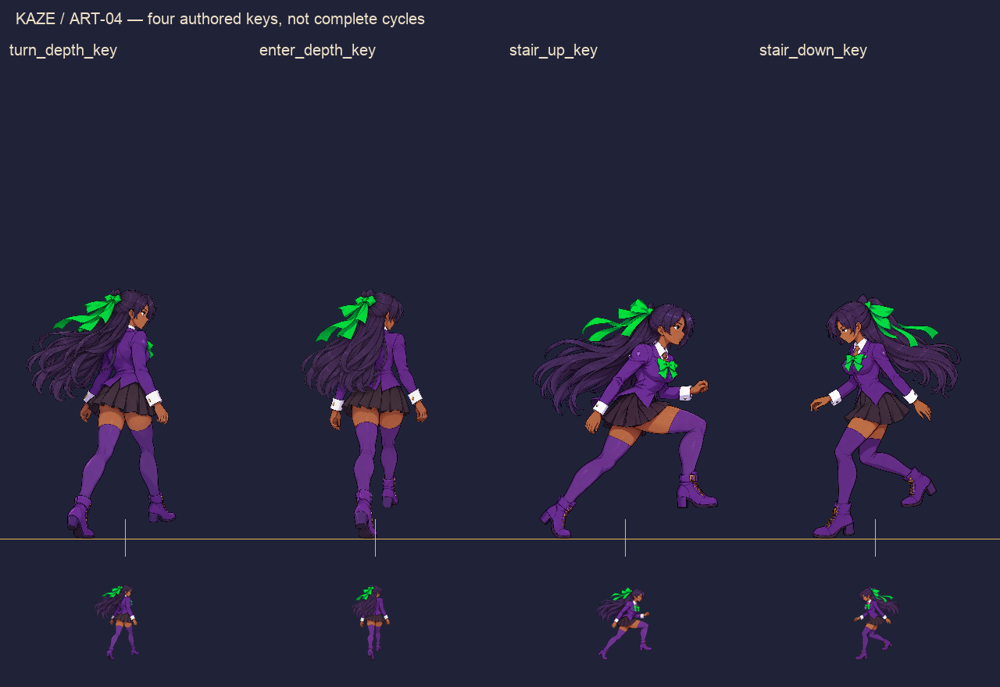
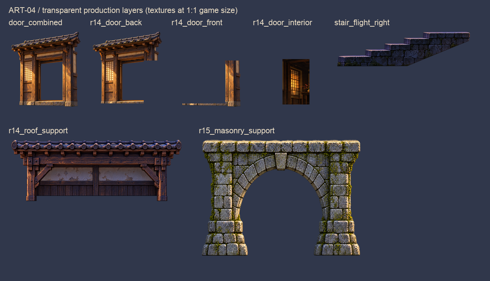

# ART-04 — production assets and native game-scale review

**Delivered:** four transparent Kaze keys and eight transparent environment textures, plus one packed key atlas. These are actual raster game assets, not diagrams. Technical import/registration checks and native static fixture review pass. Creator acceptance and playable integration remain pending.

## Review the actual game scale

- [R14/R15 before and after](GAME_SCALE_COMPARISON.png): each view retains its original 1280 × 720 pixels, zoom 1.0; comparison sheet has two columns.
- [Four keys in native room fixtures](POSES_IN_ENGINE.png).
- Individual native captures: [turn](captures/turn_depth_key.png), [entry](captures/enter_depth_key.png), [ascent](captures/stair_up_key.png), [descent](captures/stair_down_key.png), [R14](captures/R14_art04.png), [R15](captures/R15_art04.png).
- [Black/white/gray/indigo alpha review](ALPHA_EDGE_REVIEW.png).
- [Technical QA](QA_RESULTS.json) / [native renderer log](NATIVE_RENDER.log).

The renderer is Godot 4.6.1 on native macOS Apple M4/OpenGL compatibility. These are **scripted static fixtures on pinned PR #27**, not a playable ART-04 build or completed transition animation. Inherited procedural roof silhouettes and large arches still overdraw some dressing; Level must resolve their scoped replacement/layer order before the final room presentation is accepted.

## Production files

| Files | Actual content |
| --- | --- |
| `assets/art04/kaze/*_key.png` | Four RGBA 320 × 724 frames: rear-quarter turn, inward step, right-up contact, left-down landing |
| `assets/art04/kaze/key_pose_atlas.png` | Four 320 × 724 cells, width1280, in the order above; not an animation cycle |
| `assets/art04/kaze/ART04_key_poses.tres` | Real Godot SpriteFrames resource, four explicitly named one-key nonloop clips |
| `assets/art04/environment/r14_door_*.png` | Interior, rear frame and front jamb/threshold with common208 × 224 canvas/pivot |
| `assets/art04/environment/door_combined.png` | Unsplit transparent frame master at game size, no interior paint |
| `assets/art04/environment/stair_*.png` | Supported four-rise flight/landing and separated 2px front lip |
| `assets/art04/environment/r14_roof_support.png` | Detailed tile/timber backing, posts and knee braces |
| `assets/art04/environment/r15_masonry_support.png` | Radial arch, keystone and two piers reaching the recovery floor |
| `assets/art04/prefabs/*.tscn` | Collision-free reusable door layers and registered key-preview node |
| `assets/art04/ART04_ASSETS.json` | Explicit names, source transforms, pivots, contacts, facing and pilot anchors |
| `assets/art04/MANIFEST.json` | PNG sizes, alpha bounds, transparency, bytes and SHA-256 |
| `source_art/art04/*_master.png` | Original high-resolution authored RGBA masters, preserved unmodified |
| `source_art/art04/*.ora` | Eight editable OpenRaster documents: four character paints with hidden root/contact guides, separated doorway layers, three environment working canvases |
| `source_art/art04/PROVENANCE.json` | Exact prompts and source references; plain-keystone correction recorded |

The ORA character/environment paints are flattened within their paint layer; body/hair/linework were not separately hand-painted. The doorway ORA has separate front/rear/interior layers. No Aseprite or PSD authoring is claimed. Generation used built-in OpenAI image_gen; requested extraction, alpha sanitation, registration and layout used Pillow. Source and review folders have `.gdignore` to keep them out of runtime imports.

## Reproduction and integration boundary

Re-export with `python tools/art04_export.py` (Pillow and NumPy; Arial font path is macOS-specific). This uses fixed, recorded source transforms; it does not regenerate art or change scale per playback frame.

The review fixtures belong on PR #27 at `c2c002267c58e991966c0eebf7e098c6e7fff769`, with only `assets/art04` and `tools/art04_review` copied from this art commit. Import the textures, then run `tools/art04_review/capture_art04.gd` through Godot with `--art04-output=/absolute/output` and `--tr03-save=/disposable/profile.json`. Do not run that fixture against the older gameplay foundation on this art branch. Rebuild review sheets and QA using `python tools/art04_review/build_review.py` after copying captures to this directory.

Read [LEVEL_HANDOFF.md](LEVEL_HANDOFF.md) for precise anchors, painting order, playback limits and missing clips. Full PM return: [ART04_PM_REPORT.md](../../agent_handoffs/ART04_PM_REPORT.md). No active gameplay or accepted artwork is replaced; no merge.
