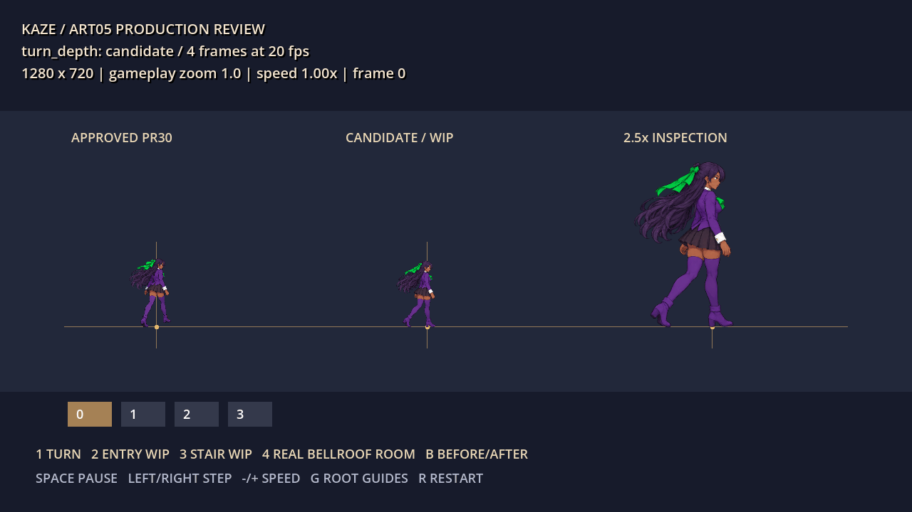
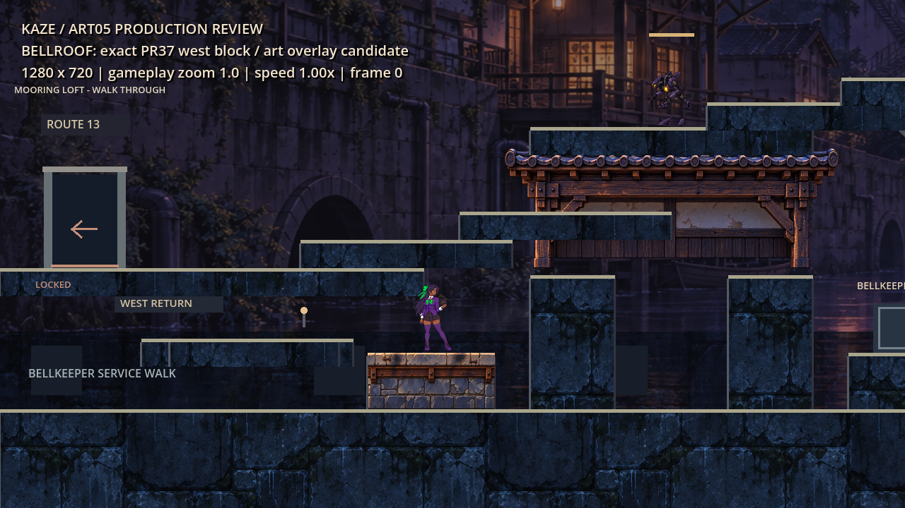

# ART-05 — animation production review

October 16, 2026 · Alpha 0.6.1 · Godot 4.6.1 · draft work, do not merge.

The reusable testbed, exporter, technical QA and Bellroof art fixture work. **One four-frame turn clip is a complete short candidate. The complete doorway and staircase transition packs are unfinished.** No new default gameplay animation is bound on this branch.

## Review motion first



This is a sequence assembled from real 1280 × 720 native Godot framebuffer samples. Each drawing lasts 50 ms (20 fps); the last drawing has an additional 400 ms review hold between repeats. It is a derived animation preview, not a continuous screen recording. The left character is the unchanged approved PR30 key; center is gameplay scale; right is a separate 2.5× inspection view. Native timed playback and Godot's nonloop `AnimatedSprite2D` playback were tested independently.

| Deliverable | Actual state |
| --- | --- |
| Animation testbed | Working; reference comparison, frame stepping, pause, speed, root guides, native captures, real Bellroof before/after |
| `turn_depth` | Four independently drawn frames: initial quarter/profile, two intermediate turns, rear settle. 20 fps / 0.20 s, nonloop. Candidate for right-to-rear turn only |
| `enter_depth` | Eight-frame WIP; crossed legs, weak alternating contacts and rear-turn seam need correction. Not production accepted |
| `stair_up` | Six-frame rejected WIP; source-cell clipping and weak weight transfer. Not a completed climb; no descent fabricated by reversing it |
| Bellroof west masonry | Original painted module, imported and rendered at exact PR37 rectangle `(520,1220,180,80)`; fixture integration only |
| Default game | PR39 unchanged; its held stair prototype remains the live baseline |

## Run the testbed

On macOS, double-click `tools/art05/Launch ART05.command` after importing the project with Godot 4.6.1. The launcher uses `/Applications/Godot.app`, with an optional `ART05_GODOT` override. On other platforms:

```sh
godot --path . --resolution 1280x720 res://tools/art05/testbed.tscn -- --test
```

Use **1** turn, **2** entry WIP, **3** stair WIP, **4** Bellroof, **Tab** next manifest clip, **Space** pause, **Left/Right** frame step, **-/+** playback speed, **G** guides, **R** restart and **B** Bellroof before/after. The room fixture is frozen and uses a separate test save path; `--test` skips normal save loading. It is not a campaign launcher. All actual gameplay-size views use zoom 1.0; the enlarged inspection character is explicitly separate.

## Production workflow

1. **Recover authority.** [Provenance](../../../source_art/art05/PROVENANCE.json) pins PR30 artwork and exact hashes. Original assets are byte-identical. [Consistency board](CHARACTER_CONSISTENCY.png) compares the actual approved key against all four turn frames. Preserve face, brown skin, hair/bun/ribbons, purple blazer, white cuffs, skirt and boots.
2. **Author keys and intermediate drawings.** High-resolution masters live in `source_art/art05/`. Turn frames 0/3 are endpoint keys and 1/2 are intermediate rotations. [Exact prompts](../../../source_art/art05/PROMPTS.json) record the built-in image-generation inputs. Do not manufacture a cycle from translation, mirroring, cross-fades or repeated held artwork.
3. **Register fixed canvases.** Edit `source_art/art05/authoring.json`: cell layout, manually reviewed source root, one uniform scale per clip, contact phase and status. No bounding-box centering, per-frame resizing, trim, deduplication or rotation. New ART04-compatible cells are **320 × 724**, pivot **(160,600)**, scale **0.303125**, centered sprite offset **(0,-238)**. Existing idle/run/combat/traversal contracts differ and are untouched.
4. **Export and inspect.** With Python/Pillow/NumPy installed, run `python tools/art05/export.py`, then `python tools/art05/verify.py`. This builds horizontal sheets, `SpriteFrames`, per-frame metadata, transparent previews and ORA sources. Rejected sources remain explicitly tagged WIP. Preserve the original master when correcting a source; adjust named transforms rather than moving the engine root to hide drift.
5. **Technical QA.** Validate PNG chunks/CRC/IEND, decode, alpha, hidden RGB, fixed cells/regions/counts, 12 px export margins, unique frame hashes, source-cell boundaries, contact contour and byte-exact preservation. Export margins cannot repair clipping that already happened in the source; the stair sheet demonstrates this failure case.
6. **Sequence review.** Watch at 1× intended rate, then pause/step. Check silhouette progression, weight transfer, arm/leg integrity, head/outfit identity, hair/ribbon lag and planted-foot drift. Inspect black/white/gray backgrounds in the authoring editor when correcting edges. Do not promote an image because only its contact sheet looks good.
7. **Godot iteration.** Import with 4.6.1, use linear filtering, lossless compression and no mipmaps, then run the native fixture below. Repair, re-export, reimport and capture again when pixels or registration change. Candidate approval and binding to the live transition owner are separate steps.

```sh
godot --headless --path . --editor --import --quit
godot --path . --resolution 1280x720 --script res://tools/art05/capture.gd -- --test
python tools/art05/package_evidence.py
```

The evidence packager expects the native log paths used in this session (`/tmp/art05-native-stdout.txt` and `/tmp/art05-regression-stdout.txt`); PNG packaging works without those optional logs. Logs and renderer provenance must describe the actual host used. See [technical QA](evidence/TECHNICAL_QA.json), [native renderer log](evidence/NATIVE_RENDER.txt), [transition regression](evidence/TRANSITION_REGRESSION.txt), [capture hashes](evidence/CAPTURE_MANIFEST.json) and [asset manifest](../../../assets/art05/MANIFEST.json).

## Bellroof geometry example



[Before](evidence/bellroof_before.png) and after use the same frozen PR37 room, player position and zoom 1.0. The new painted cap, repaired timber and soot-darkened stone face occupy exactly the existing west service block. No decoration extends across the adjacent gap or upward return. The surrounding existing room remains prototype dressing. The new module is an original built-in image-generation drawing conditioned on PR30 architecture, with deterministic crop/resizing and an opaque backing inside its exact solid rectangle. It suggests damaged refuge infrastructure after the attack; no new narrative pickup or survivor claim is introduced.

## Sources and limitations

Four high-resolution RGBA masters, exact prompts, registration JSON, three OpenRaster frame stacks and generated runtime manifests are supplied. ORA layers contain complete flattened painted frames plus a hidden registration guide. They do **not** contain separated body/line/hair animation rigs or an Aseprite/PSD source. No third-party reference clip or extracted artwork is redistributed.

No full doorway entrance/emergence/return sequence, completed stair gait/descent/landing, alternate-facing approval, Canal reskin, default gameplay binding, exported game package, Windows native run, human campaign/gamepad test or sustained FPS certification is claimed. See [TR39 handoff](TRANSITION_HANDOFF.md) and the [PM report](../../agent_handoffs/ART05_PM_REPORT.md).
