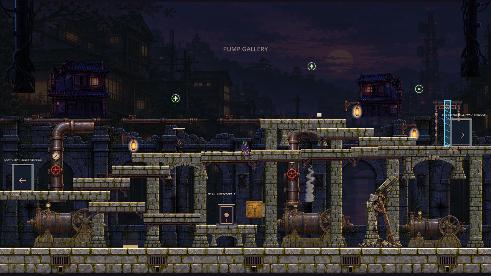

# ART-06: R18 Pump Gallery environmental production pilot

Status: **draft for creator review. Not integrated, not merged.** Runtime scripts, physics, colliders, saves, progression and all approved artwork are byte-identical to PR41 (`60859a8`).

Stacked on PR41 (`art/art05-animation-pipeline`), which sits on PR39 / PR37. Approved direction inspected first: PR28 ART-03 paintings and PR30 ART-04 environment layers. Narrative framing: PR38 ST-03 (R18 = Root Conservatory pump distribution; post-attack district, not the clan refuge). Related issue: #43.

## What is here

| Deliverable | Location |
|---|---|
| Three painted production concepts (1920 px review + high-res master) | `concepts/` |
| Reusable modular set, 16 transparent PNGs at game scale (1 px = 1 world px, zoom 1.0), lossless import | `assets/art06/r18/` |
| Asset sheet with production dimensions | `review/MODULAR_SET_SHEET.png` |
| Editable layered source (OpenRaster; opens in Krita / GIMP / MyPaint) with hidden collider + keep-clear guide layer | `review/r18_dressing_layers.ora` |
| Generated high-resolution transparent masters | `masters/*.webp` (lossless) |
| Native Godot 4.6.1 BEFORE captures + full collider dump | `captures/before/` |
| Native Godot 4.6.1 AFTER captures with the proposed hooks applied (real engine render, not a paint-over) | `captures/native_after/` |
| Registered before/after boards and collision-agreement overlays | `review/BEFORE_AFTER_A.jpg`, `review/BEFORE_AFTER_B.jpg`, `review/COLLISION_AGREEMENT.jpg` |
| Layer + collision contract (machine-readable) | `assets/art06/r18/r18_layout.json` |
| Godot implementation handoff for Codex and Level Masta | `IMPLEMENTATION_HANDOFF.md` |
| Quality control notes and open issues | `QC_NOTES.md` |
| Generation provenance (model, references, job ids) | `GENERATION_RECORD.json` |



## Geometry basis (important)

Level Masta has **not** yet published an R18 redesign for #43. Rather than invent collision, this pilot dresses the colliders the runtime actually builds today, dumped natively from Godot (`captures/before/r18_geometry.json`): the floor, 5 authored shelves and the 10 interpolated "stair slabs" #43 wants replaced. The slabs are tagged `interim_catwalk` in the layout and dressed as timber-braced catwalks so they read as built structure, but they are expected to change. Every asset is modular and positioned by data, so re-fitting to the new geometry is a JSON edit plus a validator run, not a repaint.

## Reproduce

```
python3 tools/art06/validate_layout.py assets/art06/r18/r18_layout.json docs/art/art06/captures/before/r18_geometry.json
python3 tools/art06/apply_proposed_hooks.py .          # throwaway patched copy in tools/art06/_patched (gitignored)
xvfb-run godot --path . --rendering-driver opengl3 --resolution 1280x720 --script res://tools/art06/capture_r18_integrated.gd -- --test
```

Results on this branch: layout validator 432 checks / 0 failures; native integrated test 9 checks / 0 failures (Godot 4.6.1 official, Linux, Mesa llvmpipe OpenGL 3); `tools/verify_baseline.py` 0 failures; `tools/verify_tr05_preservation.py` 0 failures.
