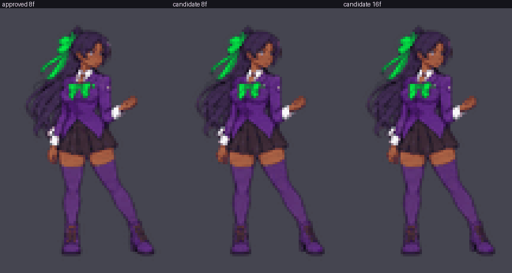
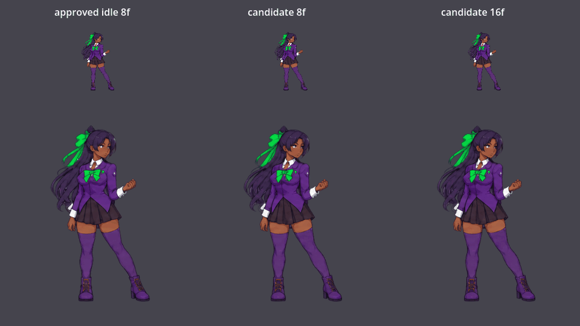

# ART-07R Phase 1: procedural idle candidate

Status: **optional visual candidate, not approved, not bound to the game.** The approved idle strip is unchanged and remains the default.

## What this is, and what it is not

Every candidate frame is made from **one approved drawing** (frame 1 of `assets/kaze/cleaned/kaze_idle_strip.png`, SHA256 `03db06f8...5697`). A deterministic script displaces its pixels with smooth fields:

- chest breathing (a gentle upward stretch above the hips, with a small chest widening)
- a restrained weight shift (upper body sways up to 3 source px, tapering to zero at the boots)
- long hair as one lagged pendulum about the ponytail base
- ribbon tails fluttering with a second harmonic

**This is pixel deformation, not redrawn animation.** It adds no new pose, expression, silhouette or artwork, and it cannot replace a hand-animated idle. Frame 0 equals the approved source frame exactly, and the rows from 548 down (boots and lower legs) are byte-identical in every frame.

## Review the motion first

Left to right: approved idle (8 frames, as in game), candidate 8f, candidate 16f. Game scale 0.265, shown at 4x.



Native Godot 4.6.1 render (software GL, 16 timed samples at 80 ms; top row real gameplay size, bottom row 3x inspection):



| File | Purpose |
| --- | --- |
| [contact_sheet_game_scale_x4.png](contact_sheet_game_scale_x4.png) | approved row vs candidate row, 8 frames each |
| [candidate_frames_0_2_4_6_native_res.png](candidate_frames_0_2_4_6_native_res.png) | native-resolution frames to check edges and identity |
| [difference_heat_frames_1_to_7.png](difference_heat_frames_1_to_7.png) | what moved (6x amplified); feet stay black |
| [candidate_8f_game_scale_x1.gif](candidate_8f_game_scale_x1.gif) | true gameplay size, 72 px wide |
| [QA_REPORT.json](QA_REPORT.json), [GODOT_VALIDATION.json](GODOT_VALIDATION.json) | machine-readable results |

## Honest read of the result

- The motion is **subtle**. The head rises about 3 source px (0.8 game px); hair and ribbon tips move at most about 7 source px (1.9 game px). At true gameplay size it reads as a faint breath and a drifting ponytail, much quieter than the approved loop, whose frame 4 drops the head top by about 19 source px.
- It uses **one pose**, so it loses the approved loop's stance variation. It is a calmer idle, not a richer one.
- The hair mask is color and polygon based. At 3x the hair edge near the left sleeve is the place to look for any shimmer; QA found no fold (displacement-field gradient 0.58 of a 1.0 fold limit) but a human eye should confirm.
- The 8-frame loop's seam delta (frame 7 to 0) is the largest adjacent delta (2.43 against 2.23 for the next), which is within the 1.5x pass bound but worth watching in motion.

## Sets

| Set | Strip | Cell | Timing | Engine change |
| --- | --- | --- | --- | --- |
| 8f | `assets/art07/idle_procedural/kaze_idle_procedural_8f_strip.png` (2176 x 724) | 272 x 724 | 0.16 s/frame, 1.28 s loop | none; same dimensions, a texture-path swap (not made) |
| 16f | `assets/art07/idle_procedural/kaze_idle_procedural_16f_strip.png` (4352 x 724) | 272 x 724 | 0.08 s/frame, 1.28 s loop | **required**: `player.gd` hardcodes `hframes = 8` and a 0.16 s idle divisor (not made) |

Registration: baseline row 591 (lowest opaque row 590 in every frame), engine scale 0.2649908807267889, `sprite.offset = (0, texture_height / 2 - 591) = (0, -229)`, `flip_h = facing < 0`. No per-frame trim, resize or recentre.

## Reproduce

```sh
python3 -I tools/art07/build_idle_candidate.py     # strips, frames, previews, QA (deterministic)
godot --headless --path . --script res://tools/art07/validate_idle_godot.gd
xvfb-run -a -s "-screen 0 1280x720x24" godot --rendering-method gl_compatibility \
  --rendering-driver opengl3 --resolution 960x540 --path . --script res://tools/art07/capture_idle_godot.gd
python3 -I tools/art07/package_evidence.py <validate_log> <capture_log>
python3 -I tools/art07/write_manifest.py           # then --verify to check hashes
```

Sources: `source_art/art07/idle_procedural/` (approved source frame, parameters, hair and ribbon masks). Parameters are in `params.json` and `tools/art07/idle_procedural.py`.
