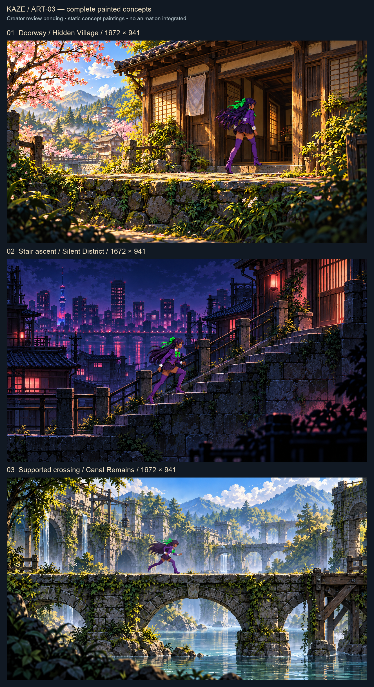

# Kaze ART-03 — complete compositions for creator review

These are **painted concepts**, not production sprites or integrated animations. All three full PNGs are 1672 × 941. Artwork approval remains pending.

| Scene | Full flattened painting master | 1280 × 720 review copy |
| --- | --- | --- |
| Hidden Village doorway | [Doorway](01_doorway.png) | [Review](review_1280_01_doorway.png) |
| Silent District stair ascent | [Staircase](02_staircase.png) | [Review](review_1280_02_staircase.png) |
| Canal Remains supported crossing | [Crossing](03_supported_crossing.png) | [Review](review_1280_03_supported_crossing.png) |

[Before and after](BEFORE_AFTER.png) • [Editable gallery layout](REVIEW_GALLERY.svg) • [Image manifest/hashes](ASSET_MANIFEST.json) • [Recovery audit](RECOVERY_AUDIT.json) • [Exact prompts and provenance](PRODUCTION_SOURCE.json) • [QA](QA_RESULTS.json) • [PM report](../../../agent_handoffs/ART03_RECOVERY_PM_REPORT.md)

## What was recovered

Recovered PR #26 at `0b96d41fa7b6b424591fdd685f5c8fdf9290c02b`, its source prompt/export script, technical contract from PR #25, approved sprite contact sheet, biome references and Art Mane continuity. The old files remain untouched in `../production_revision/`.

All four PR #26 PNGs fail strict decoding, PNG chunk integrity checks and the recorded SHA-256/byte-size claims. The master is only 786,443 bytes although its manifest claims 3,149,224. It has a 1672 × 941 header but only its upper doorway scanlines decode. Partial decoding of the individual previews reveals upper portions of their respective scenes. The export script additionally divides one landscape canvas into three shallow strips. Missing visual data cannot be restored by changing crop coordinates. The precise cause of binary damage is unknown; no claim is made that the original generation lacked full content before publication.

The three new paintings reconstruct the missing compositions using the surviving direction and canonical references. They are not lossless repairs. The comparison's black areas are explicitly decoder fill, not intentional original artwork.

## Sources and reproduction

The three full PNGs are the original, unmodified generated raster masters for this pass. No layered painting source exists; an editable SVG gallery and deterministic layout/audit script are supplied. Rebuild gallery, comparisons, review copies and integrity audit with Pillow using `python tools/art03_review.py` from the repository root. The script defaults to macOS Arial; change the font path on other systems. The art itself is not deterministically regenerated by that script.

Used: built-in OpenAI image generation, Pillow for review layouts/partial decode/integrity inspection, Git and GitHub. No Higgsfield or Aseprite authoring is claimed.

## Next production phase

Retain [SPRITE_PACK_SPEC.md](../SPRITE_PACK_SPEC.md) and [transition_art_contract.json](../transition_art_contract.json): 30 new frames (walk 6, depth turn 4, entry 3, exit 3, return profile 2, ascent 6, descent 6), plus preserved existing run. New frame canvas 320 × 724, foot anchor (160,600), at least 12px alpha margin. No new sprites were produced here.

After creator review of these paintings, author the rear-turn/contact key poses against actual sprite swatches, then distinct ascent/descent and walk clips. Audit the proposed 97px upright display, anchors, contacts, alpha edges and facing variants before integration. The review paintings use closer framing for pose evaluation; the 1280 × 720 copies are not zoom-1 gameplay captures and do not certify exact sprite scale.

PR #27 at `c2c002267c58e991966c0eebf7e098c6e7fff769` has labeled staging placeholders: R14/R13 opt-in depth demonstration, R14/R17 stairs, R15/R16 horizontal continuation. Coordinate later through its render adapter and actual endpoint metadata; retain 0.65s/39-tick loader behavior and existing run registration. These paintings do not approve room geometry, new endpoints, lore, global dressing, or runtime integration. No merge.
