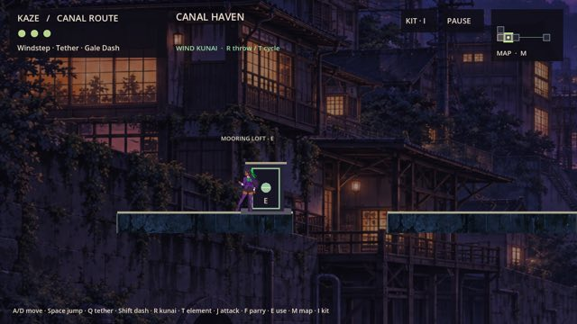
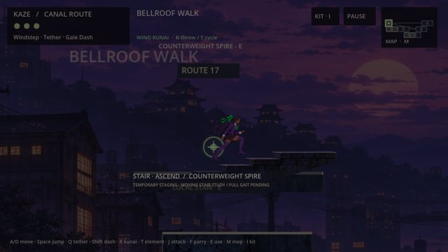
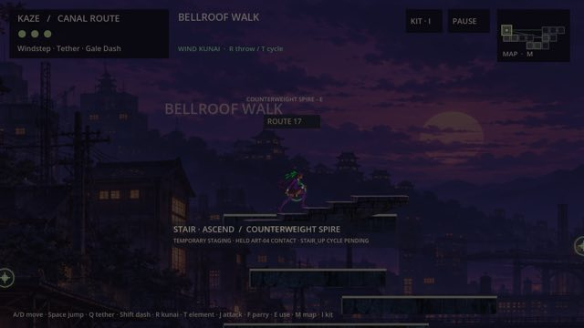

# BUILD-05 integrated Mac candidate

Gameplay source is PR39 `5dfc4c4f077c5408ecbe49f1cafafea1dcb1003c`, including
PR37 Bellroof geometry and prior approved art. The dedicated controls branch is
`ci/build05-integrated-macos`, draft [PR40](https://github.com/cappy2yappy/momentum-fractured/pull/40).
No gameplay, assets, map geometry, controller, save identity or progression changes
are included in this build work.

The [PM return](../agent_handoffs/BUILD05_PM_REPORT.md) records the accepted Actions
run, exact download, hashes, native QA scopes, limitations and review instructions.
The [build controls](../../tools/build05/README.md) describe reproduction and how
external fixtures mount the shipped PCK. The source suites and preservation checks
are inherited from PR39. Four presentation suites explicitly exercise legacy modes;
current default passage/stair behavior has separate source and native fixtures.

Stair presentation is unfinished: translated approved held poses and a bounded
camera treatment, with gait, distinct walking and outward/arrival cycles pending.
Reduced motion is session-only F6/CLI and uses a fixed pose/camera with a plain fade.
The app is unsigned and unnotarized; native scripted QA does not imply an earned
human campaign, physical gamepad validation or sustained performance certification.

## Native Apple Silicon capture previews

These JPEG review derivatives come from 36 native1280×720 captures against the
exact downloaded accepted Mac PCK, with scripted Godot key events. Raw PNG hashes
are in [VERIFICATION.json](evidence/VERIFICATION.json); images show fixture states,
not a human campaign. Full original captures remain in the ignored local QA output.

