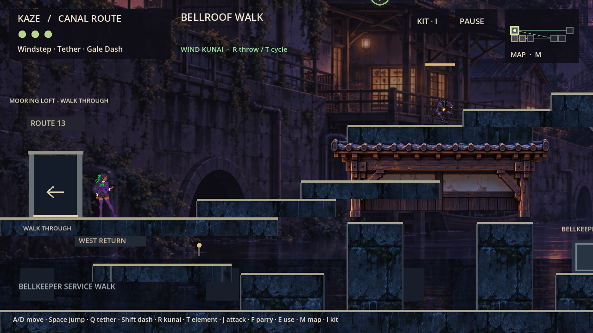

# BUILD-06 playtest comparisons

Current source is the frozen **PR39 baseline control**, not the unfinished TR07/LD04
combined candidate. The normal game uses only its previous assets. No new ART06
lateral/R18 art or ART07 idle, waiting or crouch candidate is activated.

Start with [the PM return](../agent_handoffs/BUILD06_PM_REPORT.md),
[integration and rollback plan](INTEGRATION_PLAN.md), and
[ancestry/conflict evidence](evidence/ANCESTRY.json).

## Local Windows coverage

Exact PR39 source, control commit `1200c0cd483bd797d435abe98a27ba3205c5bb35`:
25 source suites/1,607 assertions; baseline verifier; 59 preservation checks;
two identical text-script exports; release boot; seven launchers; 252 exported
resource assertions. The packaged graphical input fixture ran on NVIDIA RTX4070
Laptop/OpenGL with 54 assertions and 36 captures. All 1,101 source files remained
unchanged. This is automated graphical coverage, not a human campaign or FPS test.

The two default compressed-token exports initially differed in two MetSys scripts.
Text-script mode removes that source-compilation ambiguity and permits direct byte
comparison of each of 59 shipped scripts against the pinned Git source. The runner
records raw pack/archive hashes separately from canonical named-resource hashes;
container byte differences do not conceal any changed resource payload.

Godot's [documented export modes](https://docs.godotengine.org/en/4.6/classes/class_editorexportpreset.html)
define text mode as 0. The override exists only during export in a disposable copy,
is recorded in the manifest/evidence, and restores original preset bytes afterward.
No physics, combat, geometry, artwork, progression, inputs or saves are rewritten.

## Important baseline limitation

Issue #42 is independently reproduced here with PR51's pinned test-only key fixture
on unchanged PR39: **211 passed / 94 failed / zero script errors**, exit 1.
This is an expected baseline defect, not an acceptance pass. The stock 25 suites and
54-key fixture do not cover all fresh jump-to-exit recovery cases. Do not treat green
build infrastructure as approval to ship that unresolved doorway behavior.

## Download verification and coverage

Accepted run [39098330966](https://github.com/cappy2yappy/momentum-fractured/actions/runs/39098330966)
passed on native Windows 2022 and Intel macOS 15.7.9. Download the
[Windows control](https://github.com/cappy2yappy/momentum-fractured/actions/runs/39098330966/artifacts/12125915950)
or [Universal Mac control](https://github.com/cappy2yappy/momentum-fractured/actions/runs/39098330966/artifacts/12125533126).
They expire November 17, 2026 at approximately 04:51/04:53 UTC (late November 16
in New York). Exact timestamps/digests are in the PM return and `evidence/ARTIFACTS.json`.
`verify_delivery.py` checks the downloaded outer archive digest, inner package
digest, every member, every resource MD5/SHA-256, exact source scripts and explicit
content labels. GitHub downloads require repository access/sign-in as applicable.

Extract the Actions ZIP and then its inner Kaze ZIP into a writable folder.
Use Play-Fresh for an isolated persistent campaign, or the six resettable demos.
Do not use a seeded demo to claim earned campaign progression. Direct EXE/app
launch uses the historical ordinary save identity; prefer supplied launchers.

Native macOS coverage must come from the macOS runner or an actual Mac. Universal
architecture presence is not an Apple Silicon execution pass. Human campaigns,
physical gamepad acceptance, sustained FPS and component-art acceptance remain
separate gates. Packages are unsigned/unnotarized internal playtests, not releases.
