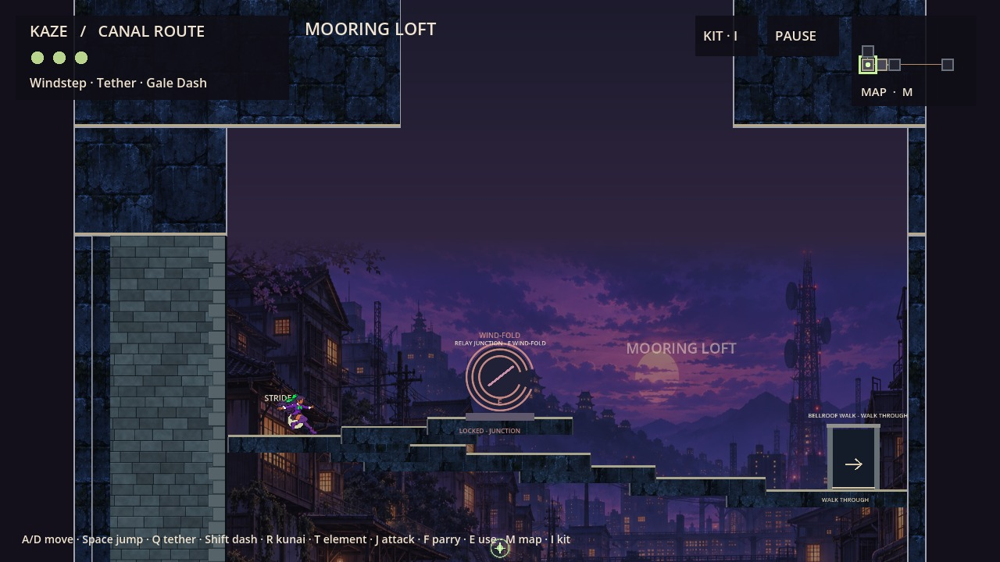
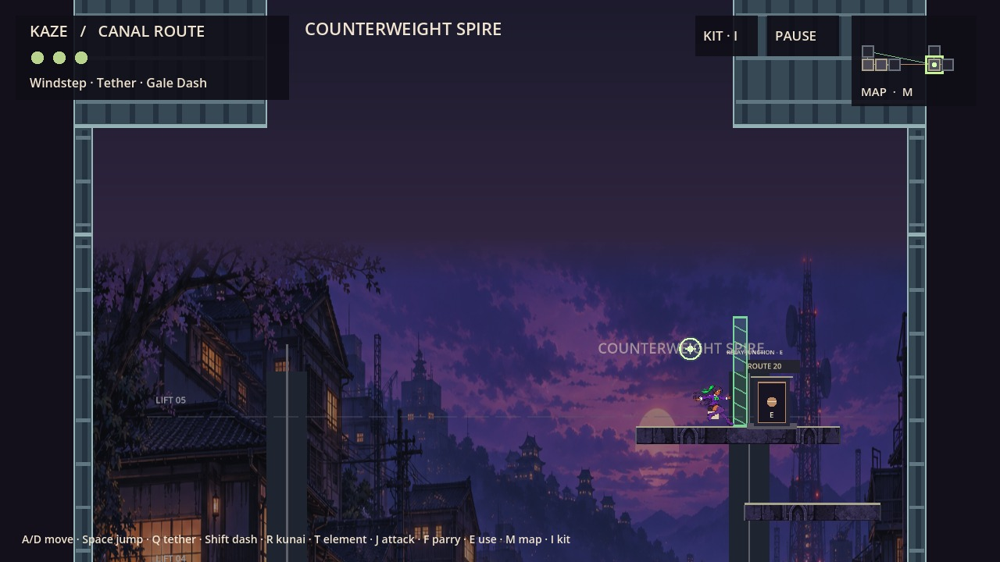

# LD-08 — Open-top boundary review

**Draft candidate; creator geometry acceptance required before production integration.**

R13 Mooring Loft and R17 Counterweight Spire now open to the sky between visible side structures. Mooring Loft continues the Canal gatehouse into a masonry upper story and adds a matching warehouse boundary at the east edge. Counterweight Spire uses ribbed hoist casings. Their projecting undersides stop side-wall climb chains; the center remains open above the old y=0 room edge. These are review geometry skins, awaiting Art Mane's production treatment.

Based on PR #77, `c2170032d08ea55268313e0020676c743251deab`. PR #37's Bellroof design and PR #63's ground repairs remain in that baseline. The other 19 rooms retain their existing geometry and roof policy. This branch does not select a world-wide roof policy or change other pending redesigns.

## Creator comparison

All images are native Godot 4.6.1 captures with identical camera settings within each view. Kaze is staged on the existing upper route for the stills; movement evidence is separately recorded in the real-input tests.

| Room | Previous open top | LD-08 candidate | Previous roof-on reference |
| --- | --- | --- | --- |
| R13 upper route | [Before](captures/before/R13_upper.jpg) | [Candidate](captures/after/R13_upper.jpg) | [Roof](captures/roof/R13_upper.jpg) |
| R13 whole room | [Before](captures/before/R13_overview.jpg) | [Candidate](captures/after/R13_overview.jpg) | [Roof](captures/roof/R13_overview.jpg) |
| R13 collision | [Before](captures/before/R13_collision.jpg) | [Candidate](captures/after/R13_collision.jpg) | [Roof](captures/roof/R13_collision.jpg) |
| R17 upper route | [Before](captures/before/R17_upper.jpg) | [Candidate](captures/after/R17_upper.jpg) | [Roof](captures/roof/R17_upper.jpg) |
| R17 whole room | [Before](captures/before/R17_overview.jpg) | [Candidate](captures/after/R17_overview.jpg) | [Roof](captures/roof/R17_overview.jpg) |
| R17 collision | [Before](captures/before/R17_collision.jpg) | [Candidate](captures/after/R17_collision.jpg) | [Roof](captures/roof/R17_collision.jpg) |

### Mooring Loft candidate



### Counterweight Spire candidate



The tradeoff is taller architecture at the sides, with a 736 px opening in R13 and a 1,032 px opening in R17. The camera can follow Kaze 800 px above the old top. The caps are solid architectural upper stories, not a horizontal ceiling across the room; there is no collision in the central sky opening. Existing upper shelves, exits, anchors, pickup and gate coordinates are unchanged.

## Interactive review

Use Godot **4.6.1**, at the repository root. The review fixture grants traversal kit and uses a disposable save path; it does not write the normal player save.

```sh
godot --path . --script res://tools/ld08/review.gd -- --test --ld08-room=13
godot --path . --script res://tools/ld08/review.gd -- --test --ld08-room=17
```

Append `--ld08-before` for the old open top, or `--ld08-roof-reference` for the original roof-on geometry. Append `--ld08-closed-gates` to retain the Spire wind shutter in the interactive fixture. Normal A/D, Space, Shift and Q controls apply. The comparison switches affect only R13/R17; existing LD-05 switches for other rooms remain available.

Review the side structures' size and material direction, the amount of visible sky, wall-jump recovery under the caps, the highest ledges, all grapple anchors, and both rooms' exits. Accept or revise this geometry before Art Mane produces final skins or PM integrates it.

- [Exact collision changes](COLLISION_CHANGES.md)
- [Traversal audit and QA](QA_REPORT.md)
- [Art Mane handoff](ART_MANE_BRIEF.md)
- [Evidence](evidence/)
