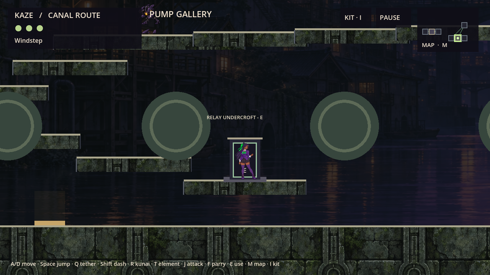
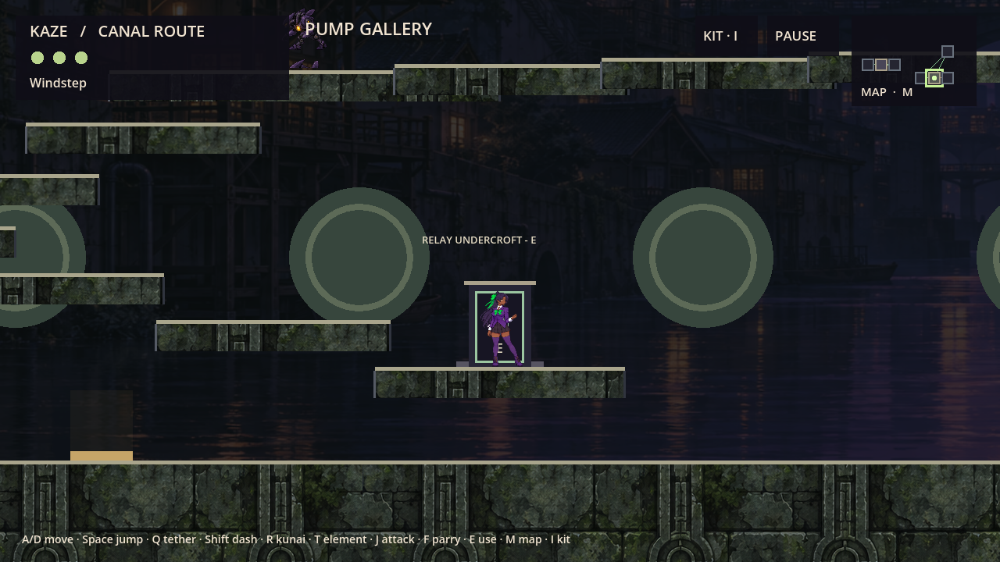
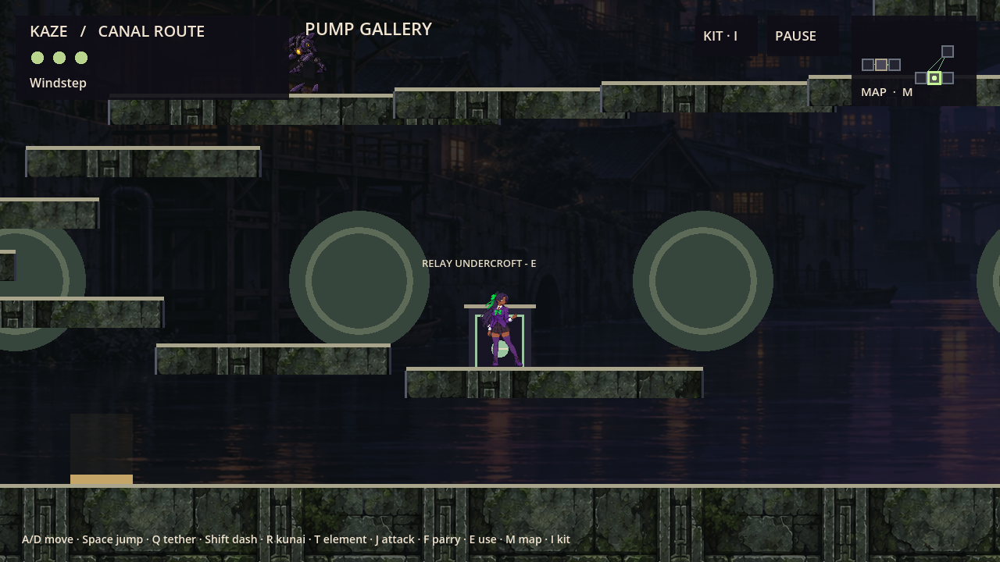
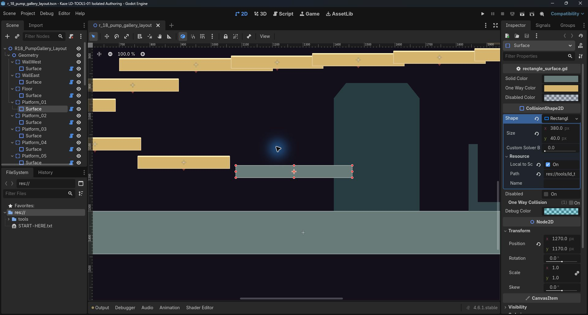

# Room Creator 2.0 — creator guide

Use Godot **4.6.1** and this PR's source checkout. The tool extends LD-TOOLS-01. It does not register new rooms or redesign R18.

## Open R18 → move a platform → save → play

1. Import the root `project.godot`. In **Project → Project Settings → Plugins**, enable **Kaze Room Creator 2.0**. This enables the editor dock only; it does not enable runtime adoption. Keep local editor configuration out of your commit.
2. In the **Room Creator** dock, choose **Open editable R18**. This opens `tools/ld_tools_02/r18_editable.tscn`. Its rectangles match the frozen pilot. **Scene → Save As** a working copy before editing; keep `tools/ld_tools_01/r18_layout.tscn` as the unchanged recovery source.
3. Select **Geometry → Platform_01 → Surface** in the Scene tree. Focus the 2D viewport and press **F** to frame it. Drag its interior to move it. Use the native orange handles to resize, or Inspector → Shape → RectangleShape2D → Size for exact dimensions. Use Transform → Position for exact coordinates. Keep Scale `(1,1)`, Rotation `0` and Skew `0`.
4. Enable Godot's **Use Snap** magnet in the 2D toolbar. Configure grid spacing in the adjacent snap menu; 16px is a useful starting point. Snapping is optional and never rounds the saved freeze automatically. Native Undo/Redo applies to moves, resizing and Inspector edits.
5. Set **One Way Collision** on for a platform, off for solid geometry. **Disabled** removes collision and excludes the rectangle from the live game's support queries. The visual authoring overlay reflects the same native collision shape.
6. Choose **Save + play with Kaze**. The tool validates and saves the scene, then starts a separate game process at the normal **1280×720** scale. An R18 layout uses the real R18 world setup, existing exits, gate, hazard, enemy, camera and controller. Other room IDs open a disconnected geometry laboratory using the same controller. The on-screen label distinguishes the laboratory from the live pilot.
7. Test with **A/D** move, **Space** jump, **Shift** dash, **Q** tether, **E** meaningful entrance. The disposable preview fixture supplies traversal abilities, kunai, Archive completion, three sigils and the intake flag so you can test existing exits. Its electric gate starts closed; cycle to electric kunai and open it through normal gameplay. Death returns to the fixture’s R18 checkpoint. These flags affect only the preview session. Close the preview window to return to the editor. Preview `--test` mode skips personal save loading and all save writes.
8. To restore the source layout, reopen the unchanged frozen scene or discard the working copy. Ordinary game launch without `--authored-r18` always uses generated geometry. Layout choices do not enter saves.

The immutable default pilot loads **`tools/ld_tools_01/r18_layout.tscn`**, not the working copy. Working-copy edits reach gameplay only through this explicit preview action. F5 still launches the ordinary game; F6 on the layout itself is not a playable Kaze preview.

## Create and edit other rooms

Choose a size template, enter a stable room ID, and choose **Create template…**. IDs 21+ identify unregistered authoring rooms; they do not expand the live map. Templates provide west/east walls and a floor, with no new roof. Available sizes are 2600×1440, 1800×2400 and 3200×1440.

**Add rectangle** inserts an independently editable one-way platform. Select the entire body and use **Duplicate selected (unique shapes)** to duplicate safely; each copy gets its own shape resource. Native Ctrl/Cmd+D is also available, but use **Make Unique** on its Shape resource before resizing a copy. Native Delete and Undo/Redo remain available.

Use **Add background decoration** or **Add foreground decoration** for non-solid Polygon2D placeholders. Move/edit the polygon in Godot's normal editor, or replace it with a Sprite2D and an approved texture. Never place physics bodies under these branches. In live R18, background props appear behind terrain and Kaze; foreground props appear in front. Avoid covering hazards or exits.

Choose a marker type and **Add metadata marker**. Entrance, exit, pickup, checkpoint and hazard markers are design metadata. They create no triggers, rewards, damage, destinations, save fields or progression. Their Inspector `design_note` records intent. Live R18 continues using its existing gameplay objects.

The version 2 root's **Show Boundaries** displays room limits and a 1280×720 reference frame. **Show Collision Overlay** toggles authoring ink. Collision remains active when its overlay is hidden. These overlays are editor-only; production terrain uses the existing renderer. Save/reload layouts through Godot's normal scene workflow. To duplicate a room, use **Scene → Save As**, then change root Metadata → `room_id` for the new room; existing identity is deliberately preserved until you change it.

## Screenshots

The native 1280×720 views below come from this branch's real R18 game scene. The unchanged authored layout should match the generated geometry. The edited example illustrates a moved/resized solid platform; it is not an approved redesign.







The inherited LD-TOOLS-01 screenshot shows the same native collider Inspector workflow. It is historical evidence, **not a screenshot of the new dock**:



New-dock mouse interaction and an updated editor screenshot remain pending while the Mac is locked. Programmatic editor tests are reported separately in [QA](QA.md).

## Command-line reproduction

From this checkout, substitute your Godot 4.6.1 executable for `GODOT`:

```sh
GODOT --path . --script res://tools/ld_tools_02/play_preview.gd -- --test --room-layout=res://tools/ld_tools_02/r18_editable.tscn
python3 tools/ld_tools_02/run_qa.py --godot GODOT
python3 tools/ld_tools_02/run_qa.py --godot GODOT --rendered --pilot-only
python3 tools/ld_tools_02/run_editor_qa.py --godot GODOT
python3 tools/ld_tools_02/verify_preservation.py
```

The automated runners use unique disposable Godot profiles. Native Godot stores these in its application-data location. Generated caches, `.uid`, `.import`, logs and temporary layouts are not deliverable source files.

[Schema and compatibility](SCHEMA.md) · [QA](QA.md) · [Rollback and PM handoff](PM_HANDOFF.md)
