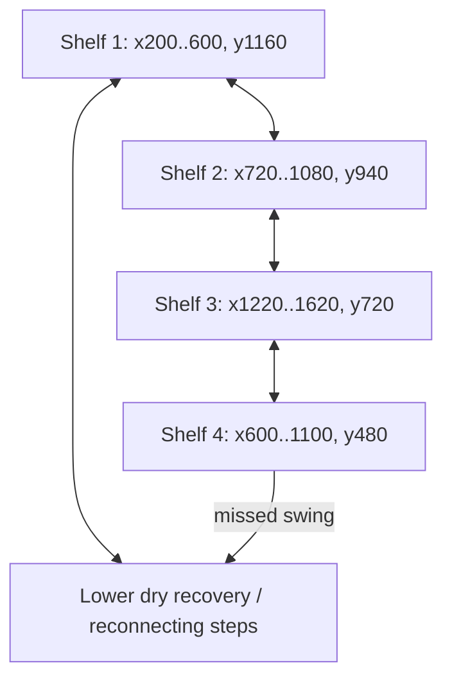
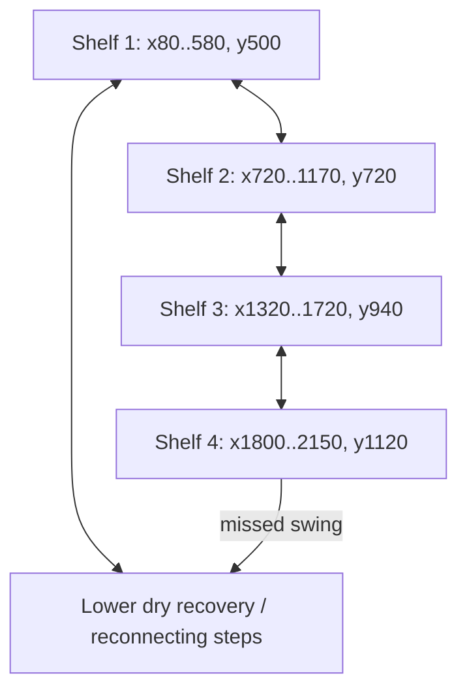
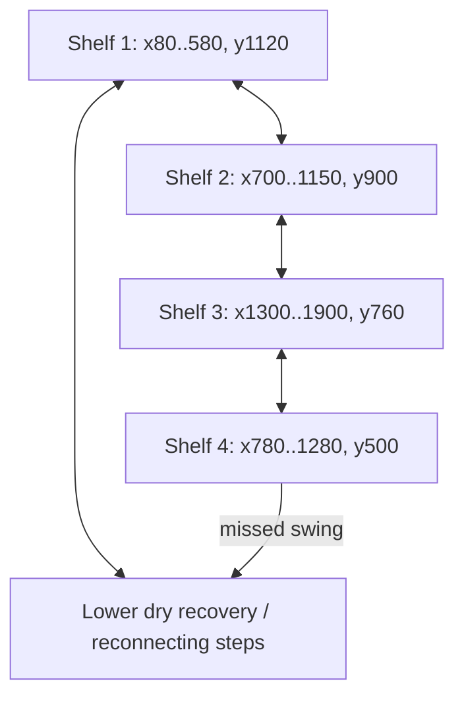
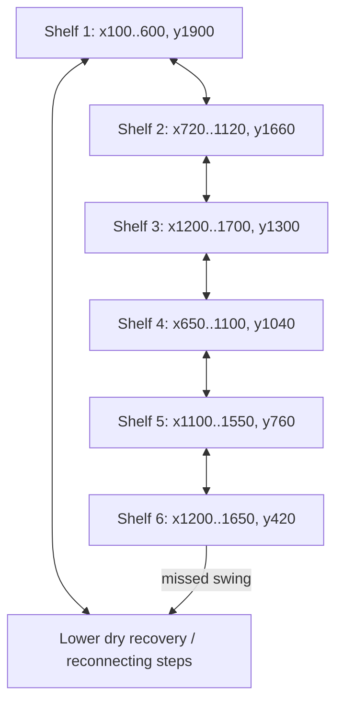
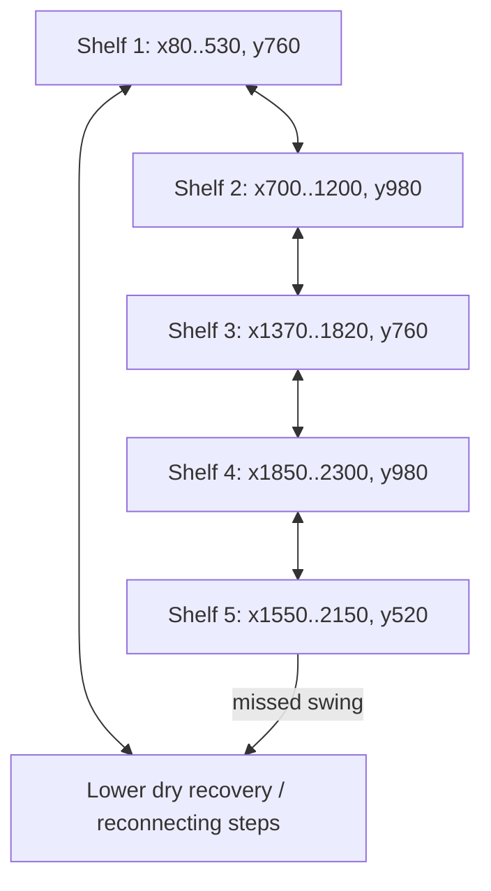
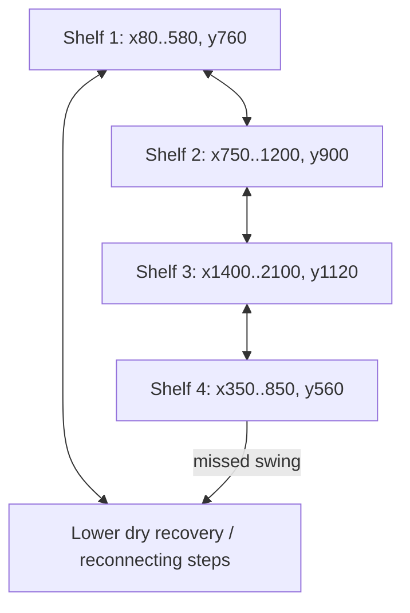

**LD-01 / 2026-10-12. Status: design proposal pending creator approval.**

Baseline: `codex/kaze-boundary-sprite-integration` at `0bf37e19ef3498386b133ed5d41e32788c2609d6`. Static source audit; no new engine playthrough or measured MV-01 values claimed. Coordinates are world pixels, origin top-left, y increases down.

## Scope and coherence

Eight append-only proposed IDs 13-20. Existing 13 remain. Root Conservatory adds a fifth region through Root Shrine, Pump Gallery and Relay Junction; rooftops and industrial spaces extend existing regions rather than pretending all environments are new. Flooded rooms already exist in name/visuals, so Lower Sluice adds a dry subterranean maintenance experience instead of duplicating the Cistern or assuming swimming. Five regions/21 rooms does not mean five keepers; boss expansion is a separate dependency outside this assignment.

Every new main line works with baseline movement abilities legitimately available at its entry; no temporary momentum threshold is mandatory. Dimensions/coordinates are blockout proposals to be adjusted to measured MV-01 envelopes. Platform diagrams below express topology, while tables give approximate spatial bounds; arrows are traversal options, not forced jumps. New lower recovery floors stay inside room bounds, with safe return ledges. No bottomless-pit room transition is promised by the existing runtime.

Annex links require completed at all new entries that could bypass R07. Protected SkyWorks access uses the three named sigils and existing Wind intake flag regardless of direction. Existing Wind/Fire/Electric seals remain effective at maximum movement. Final shared contract approval precedes collision implementation.

## N13 - MOORING LOFT

- Biome: Canal Ward rooftop fringe; proposed dimensions 1800 x 1440.
- Purpose: A compact return overlook above the Haven; first optional branch and two visible choices.
- Elevation: main shelves y=1160  940  720  480.

| Portal | Position | Connection and required flag |
|---|---|---|
| P120_1200 | (120,1200) | R00, Windstep |
| P1680_560 | (1680,560) | N14 |
| P900_400 | (900,400) | N20 return switch, initially locked |

### Layout and traversal

Proposed platforms `(x,y,w,h)`: (200, 1160, 400, 40); (720, 940, 360, 40); (1220, 720, 400, 40); (600, 480, 500, 40). All have readable top edges, walls/roof around elemental alcoves, and separate background art. Portal landings require width � player stopping envelope plus arrival clearance, measured by MV-01.

- Grapple points: (900, 690). Bell on timber mooring crane; jump from y940, swing toward y720; lower y1200 quay catches misses.
- Expected attach range: MV-01 approved value, pending; use current 80..400 eligibility for initial feasibility probes. Avoid beams/platforms inside rope arcs and keep approach airborne with anchor above origin.
- Hazards/enemies: One guard on wide middle shelf only after lane safety exists; no moving hazard on teaching line.
- Gates/rewards/secrets: Optional exploration speed upgrade on upper nook (450,440), obtainable without temporary bonus; lore at lower quay.
- Backtracking: N20 return makes long regional loop terminate at starting shrine.
- Failure/recovery: solid lower recovery surface and reconnecting ledge ladder; hazards permit retreat and reset without losing permanent rewards. Never respawn inside a closed gate or hazard.
- Technical dependencies: Map/branch portal support and movement-upgrade persistence supplied by developer/MV-01.
- Acceptance: traverse every listed portal both ways; complete ordinary lane at baseline without temporary bonus; fail every swing and recover; locked route/reward stays closed under max speed and every alternate entry; save/reload and death preserve rewards/shortcuts; identify this room's purpose and return path during unseeded playtest.

## N14 - BELLROOF WALK

- Biome: Canal Ward elevated city; proposed dimensions 2600 x 1440.
- Purpose: Roof promenade offering a steady stair route and faster hanging-bell line.
- Elevation: main shelves y=1100  900  720  830.

| Portal | Position | Connection and required flag |
|---|---|---|
| P120_1100 | (120,1100) | N13 |
| P2440_830 | (2440,830) | R09, original relay completed |
| P1450_480 | (1450,480) | N17 |

### Layout and traversal

Proposed platforms `(x,y,w,h)`: (100, 1100, 500, 40); (750, 900, 400, 40); (1300, 720, 450, 40); (1900, 830, 600, 40). All have readable top edges, walls/roof around elemental alcoves, and separate background art. Portal landings require width � player stopping envelope plus arrival clearance, measured by MV-01.

- Grapple points: (820, 620), (1460, 430), (2090, 550). Bells on roof crossbeams; staged airborne launches from middle ledges, release to broad next roof; lower service walkway y1280.
- Expected attach range: MV-01 approved value, pending; use current 80..400 eligibility for initial feasibility probes. Avoid beams/platforms inside rope arcs and keep approach airborne with anchor above origin.
- Hazards/enemies: Two separated guard lanes; optional timed falling roof debris with clear shadow, safe waiting bays.
- Gates/rewards/secrets: Momentum-only timed roof note at (1700,390) is optional; mastery reward is lore, not mandatory ability.
- Backtracking: N13R09 bypasses repeated central traversal after relay restoration.
- Failure/recovery: solid lower recovery surface and reconnecting ledge ladder; hazards permit retreat and reset without losing permanent rewards. Never respawn inside a closed gate or hazard.
- Technical dependencies: Debris telegraph/recovery system; gate/map integration; all range values pending MV-01.
- Acceptance: traverse every listed portal both ways; complete ordinary lane at baseline without temporary bonus; fail every swing and recover; locked route/reward stays closed under max speed and every alternate entry; save/reload and death preserve rewards/shortcuts; identify this room's purpose and return path during unseeded playtest.

## N15 - LOWER SLUICE

- Biome: Canal Ward underground; proposed dimensions 2200 x 1440.
- Purpose: Dry maintenance route through a visibly flooded reservoir; aquatic space reserved for later approved swimming.
- Elevation: main shelves y=500  720  940  1120.

| Portal | Position | Connection and required flag |
|---|---|---|
| P120_500 | (120,500) | R02, Wind sluice opened |
| P2080_1120 | (2080,1120) | N16 |

### Layout and traversal

Proposed platforms `(x,y,w,h)`: (80, 500, 500, 40); (720, 720, 450, 40); (1320, 940, 400, 40); (1800, 1120, 350, 40). All have readable top edges, walls/roof around elemental alcoves, and separate background art. Portal landings require width � player stopping envelope plus arrival clearance, measured by MV-01.

- Grapple points: (960, 480), (1550, 660). Masonry rings over dry platforms; descend in controlled stages, recover on lower dry floor y1300. Water behind collision-separated background plane.
- Expected attach range: MV-01 approved value, pending; use current 80..400 eligibility for initial feasibility probes. Avoid beams/platforms inside rope arcs and keep approach airborne with anchor above origin.
- Hazards/enemies: One guard on y940 terrace; intermittent spill jet in optional lane, with separate safe dry bypass.
- Gates/rewards/secrets: Hidden inspection record behind a Wind alcove; no swimming-dependent main reward.
- Backtracking: Links Cistern to Root Shrine/Undercroft without traversing old upper chain; annex access requires completed.
- Failure/recovery: solid lower recovery surface and reconnecting ledge ladder; hazards permit retreat and reset without losing permanent rewards. Never respawn inside a closed gate or hazard.
- Technical dependencies: Water visuals separate from interaction; spill hazard implementation; future swimming explicitly deferred.
- Acceptance: traverse every listed portal both ways; complete ordinary lane at baseline without temporary bonus; fail every swing and recover; locked route/reward stays closed under max speed and every alternate entry; save/reload and death preserve rewards/shortcuts; identify this room's purpose and return path during unseeded playtest.

## N16 - ROOT SHRINE

- Biome: Root Conservatory new fifth region; proposed dimensions 2000 x 1440.
- Purpose: A quiet overgrown shrine linking underground and working machinery; rest and exploration junction.
- Elevation: main shelves y=1120  900  760  500.

| Portal | Position | Connection and required flag |
|---|---|---|
| P120_1120 | (120,1120) | N15 |
| P1880_760 | (1880,760) | R08, relay completed |
| P1000_430 | (1000,430) | N18 |

### Layout and traversal

Proposed platforms `(x,y,w,h)`: (80, 1120, 500, 40); (700, 900, 450, 40); (1300, 760, 600, 40); (780, 500, 500, 40). All have readable top edges, walls/roof around elemental alcoves, and separate background art. Portal landings require width � player stopping envelope plus arrival clearance, measured by MV-01.

- Grapple points: (950, 630), (1530, 470). Wind relic mounted under stone arch; gentle ascent with broad resting ledges; lower moss floor catches misses.
- Expected attach range: MV-01 approved value, pending; use current 80..400 eligibility for initial feasibility probes. Avoid beams/platforms inside rope arcs and keep approach airborne with anchor above origin.
- Hazards/enemies: No mandatory encounter; optional guard watches upper treasure off shrine path.
- Gates/rewards/secrets: E checkpoint proposed at (420,1120); permanent movement upgrade in exploration nook, exact effect pending MV-01.
- Backtracking: Two underground entries provide useful navigation choice; N18 upper passage loops to Undercroft.
- Failure/recovery: solid lower recovery surface and reconnecting ledge ladder; hazards permit retreat and reset without losing permanent rewards. Never respawn inside a closed gate or hazard.
- Technical dependencies: Checkpoint safe spawn/IDs; upgrade persistence; new biome art with no obstruction of silhouettes.
- Acceptance: traverse every listed portal both ways; complete ordinary lane at baseline without temporary bonus; fail every swing and recover; locked route/reward stays closed under max speed and every alternate entry; save/reload and death preserve rewards/shortcuts; identify this room's purpose and return path during unseeded playtest.

## N17 - COUNTERWEIGHT SPIRE

- Biome: Echo Works rooftop tower; proposed dimensions 1800 x 2160.
- Purpose: A purposeful multi-screen vertical climb with rest landings and an optional fast swing ascent.
- Elevation: main shelves y=1900  1660  1300  1040  760  420.

| Portal | Position | Connection and required flag |
|---|---|---|
| P120_1900 | (120,1900) | R05, Dash + Tether |
| P1680_1300 | (1680,1300) | N14 |
| P1500_420 | (1500,420) | N20, Wind shutter + relay completed |

### Layout and traversal

Proposed platforms `(x,y,w,h)`: (100, 1900, 500, 40); (720, 1660, 400, 40); (1200, 1300, 500, 40); (650, 1040, 450, 40); (1100, 760, 450, 40); (1200, 420, 450, 40). All have readable top edges, walls/roof around elemental alcoves, and separate background art. Portal landings require width � player stopping envelope plus arrival clearance, measured by MV-01.

- Grapple points: (900, 1400), (950, 780), (1320, 470). Rings on fixed tower beams; reversible zigzag from y1900 to420; side landings catch misses one stage below, no whole-tower fall.
- Expected attach range: MV-01 approved value, pending; use current 80..400 eligibility for initial feasibility probes. Avoid beams/platforms inside rope arcs and keep approach airborne with anchor above origin.
- Hazards/enemies: Optional counterweight moving platform occupies separate lane with crush-safe endpoints; one guard on y1300 rest bay beyond arrival.
- Gates/rewards/secrets: Upper mastery note; no required upgrade behind timed ascent.
- Backtracking: Mid-height N14 exit lets players leave climb and return later; upper N20 closes regional circuit.
- Failure/recovery: solid lower recovery surface and reconnecting ledge ladder; hazards permit retreat and reset without losing permanent rewards. Never respawn inside a closed gate or hazard.
- Technical dependencies: Per-room camera/bounds/fall recovery support, moving-platform collision, swept swing measurements. No active camera change in LD pass.
- Acceptance: traverse every listed portal both ways; complete ordinary lane at baseline without temporary bonus; fail every swing and recover; locked route/reward stays closed under max speed and every alternate entry; save/reload and death preserve rewards/shortcuts; identify this room's purpose and return path during unseeded playtest.

## N18 - PUMP GALLERY

- Biome: Root Conservatory / industrial interface; proposed dimensions 2600 x 1440.
- Purpose: Machinery reclaimed by roots; a looping horizontal route with readable branching above a safe service floor.
- Elevation: main shelves y=1000  800  620  760.

| Portal | Position | Connection and required flag |
|---|---|---|
| P120_1000 | (120,1000) | N16 |
| P2440_760 | (2440,760) | N19, Electric isolator + three sigils + Wind intake |
| P1200_1180 | (1200,1180) | R08, relay completed |

### Layout and traversal

Proposed platforms `(x,y,w,h)`: (80, 1000, 500, 40); (700, 800, 500, 40); (1380, 620, 450, 40); (2000, 760, 500, 40). All have readable top edges, walls/roof around elemental alcoves, and separate background art. Portal landings require width � player stopping envelope plus arrival clearance, measured by MV-01.

- Grapple points: (930, 510), (1650, 340), (2220, 460). Bracket rings on stationary pump frame; optional aerial shortcut over pump housings, lower stepping lane remains viable.
- Expected attach range: MV-01 approved value, pending; use current 80..400 eligibility for initial feasibility probes. Avoid beams/platforms inside rope arcs and keep approach airborne with anchor above origin.
- Hazards/enemies: One guard on broad y800 deck; two timed steam vents only on mastery lane with warning and sheltered waiting niches.
- Gates/rewards/secrets: Electric-gated maintenance cache; optional permanent speed challenge upgrade with untimed alternative exploration source per MV-01.
- Backtracking: N16N18R08 loop reconnects shrine; Electric isolator opens later machinery access.
- Failure/recovery: solid lower recovery surface and reconnecting ledge ladder; hazards permit retreat and reset without losing permanent rewards. Never respawn inside a closed gate or hazard.
- Technical dependencies: Steam telegraphs; reward ownership/persistence; protected cross-region transitions.
- Acceptance: traverse every listed portal both ways; complete ordinary lane at baseline without temporary bonus; fail every swing and recover; locked route/reward stays closed under max speed and every alternate entry; save/reload and death preserve rewards/shortcuts; identify this room's purpose and return path during unseeded playtest.

## N19 - COIL SERVICE HALL

- Biome: SkyWorks industrial; proposed dimensions 2400 x 1440.
- Purpose: Power-routing passage that makes Electric and Fire access visibly causal.
- Elevation: main shelves y=760  980  760  980  520.

| Portal | Position | Connection and required flag |
|---|---|---|
| P120_760 | (120,760) | N18, Electric isolator + required regional flags |
| P2280_980 | (2280,980) | R11, three sigils + Wind intake |
| P1800_480 | (1800,480) | N20, Fire service seal |

### Layout and traversal

Proposed platforms `(x,y,w,h)`: (80, 760, 450, 40); (700, 980, 500, 40); (1370, 760, 450, 40); (1850, 980, 450, 40); (1550, 520, 600, 40). All have readable top edges, walls/roof around elemental alcoves, and separate background art. Portal landings require width � player stopping envelope plus arrival clearance, measured by MV-01.

- Grapple points: (890, 670), (1580, 430). Insulated rings on crane beams; deliberate side swing between y980/y760; safe lower floor avoids conductive hazard lanes.
- Expected attach range: MV-01 approved value, pending; use current 80..400 eligibility for initial feasibility probes. Avoid beams/platforms inside rope arcs and keep approach airborne with anchor above origin.
- Hazards/enemies: One guard on y980 floor bay; optional pulsing coil field confined to side channel, never arrival/checkpoint.
- Gates/rewards/secrets: Fire-enclosed service lore cache and route; no new combat archetype assumption.
- Backtracking: Opens alternate access to Foundry but retains its Wind-entry and Electric-Keeper story locks.
- Failure/recovery: solid lower recovery surface and reconnecting ledge ladder; hazards permit retreat and reset without losing permanent rewards. Never respawn inside a closed gate or hazard.
- Technical dependencies: Electric hazard eligibility separate from Electric Kunai ownership; no automatic immunity assumed.
- Acceptance: traverse every listed portal both ways; complete ordinary lane at baseline without temporary bonus; fail every swing and recover; locked route/reward stays closed under max speed and every alternate entry; save/reload and death preserve rewards/shortcuts; identify this room's purpose and return path during unseeded playtest.

## N20 - RELAY JUNCTION

- Biome: Root Conservatory upper ruins; proposed dimensions 2200 x 1440.
- Purpose: Overgrown relay garden joining roofs and service tunnels; backtracking reward and route-choice hub.
- Elevation: main shelves y=760  900  1120  560.

| Portal | Position | Connection and required flag |
|---|---|---|
| P120_760 | (120,760) | N17, Wind shutter + relay completed |
| P2080_1120 | (2080,1120) | N19, Fire service seal + regional flags |
| P600_520 | (600,520) | N13 return after junction switch and regional flags |

### Layout and traversal

Proposed platforms `(x,y,w,h)`: (80, 760, 500, 40); (750, 900, 450, 40); (1400, 1120, 700, 40); (350, 560, 500, 40). All have readable top edges, walls/roof around elemental alcoves, and separate background art. Portal landings require width � player stopping envelope plus arrival clearance, measured by MV-01.

- Grapple points: (900, 520), (1650, 700). Wind relic under root-bound arch; quick aerial line and slower broad stairs converge at switch; lower floor catches misses.
- Expected attach range: MV-01 approved value, pending; use current 80..400 eligibility for initial feasibility probes. Avoid beams/platforms inside rope arcs and keep approach airborne with anchor above origin.
- Hazards/enemies: One optional shrine guard on a treasure lane; safe hub switch and arrival shelves.
- Gates/rewards/secrets: Exploration speed upgrade in lower side nook; switch opens surface return; ledger ties shrine/industrial history together.
- Backtracking: N17N20N19 forms upper-to-lower loop; N20N13 makes return to Haven useful.
- Failure/recovery: solid lower recovery surface and reconnecting ledge ladder; hazards permit retreat and reset without losing permanent rewards. Never respawn inside a closed gate or hazard.
- Technical dependencies: Shortcut flag/save owner; map edge state; environmental layer art. No new boss scope implied.
- Acceptance: traverse every listed portal both ways; complete ordinary lane at baseline without temporary bonus; fail every swing and recover; locked route/reward stays closed under max speed and every alternate entry; save/reload and death preserve rewards/shortcuts; identify this room's purpose and return path during unseeded playtest.

## Explicit edge prerequisites for developer integration

Every direction of an edge must use the shared prerequisite; an opened seal adds to, never replaces, these story requirements. N13N14 remains optional early exploration after Windstep. N14N17 and R05N17 both require Tether + Dash; N17N20 additionally requires completed and Wind shutter. R02N15 requires Wind sluice; N15N16 requires completed, preventing an early route into annex spaces. N16N18 and N18R08 require completed. N18N19, N19R11 and N19N20 require completed, all three named existing sigils and skyworks_wind_intake; add Electric isolator for N18N19 and Fire seal for N19N20. N20N13 requires all regional flags plus the junction switch. N14R09 and N16R08 require completed. No proposed direct edge enters R12 or sets boss/attunement flags.

