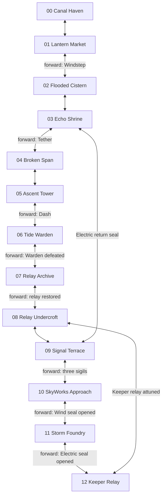
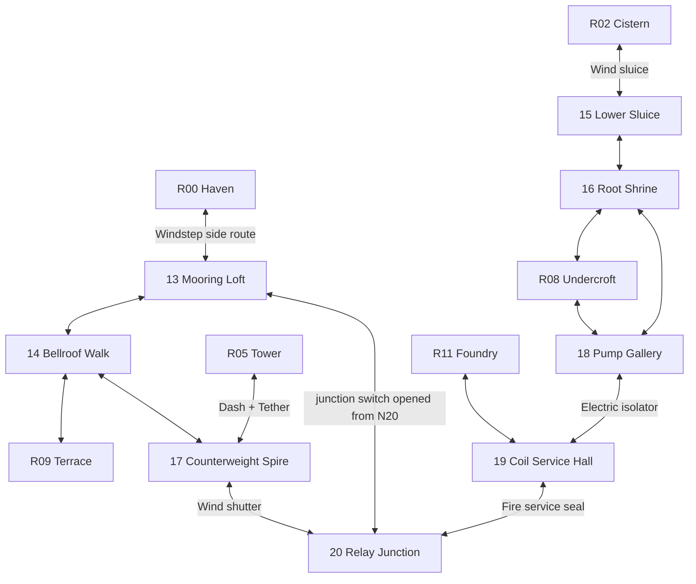

**LD-01 / 2026-10-12. Status: design proposal pending creator approval.**

Baseline: `codex/kaze-boundary-sprite-integration` at `0bf37e19ef3498386b133ed5d41e32788c2609d6`. Static source audit; no new engine playthrough or measured MV-01 values claimed. Coordinates are world pixels, origin top-left, y increases down.

## Verified runtime graph

Solid ordinary edges are reciprocal E portals, not literal gaps between screens. Labels show forward requirements; ordinary reverse routes are open. Shortcut requirements apply in both directions. The map currently discovers index neighbors, not shortcut neighbors; drawing new connections must consume actual edge data.

Source: world.gd interact/can_enter/request_room, route_extension.gd interact, skyworks_region.gd interact. R07 completion has an Electric physical seal but no flag guard at its console; this is a proposed fix, not an existing graph requirement. No existing direct fall transitions.

## Shortcut exact arrivals

| Edge | Departure | Destination landing | Requirement |
|---|---|---|---|
| R09  R03 | (160,620), radius 100 | (2100,788) | terrace_return_relay |
| R03  R09 | (2250,790), radius 100 | (480,618) | same |
| R08  R12 | (1470,740), radius 95 | (430,828) | skyworks_restored |
| R12  R08 | (220,830), radius 95 | (1590,738) | same |

R12 return landing is on R12 platform y=830, x=80..560. R08 landing is on y=740, x=1300..1640. These fit current static geometry; verify settling and collision live after any approved changes.

## Proposed expansion graph

All new edges below are proposals; 13 existing + 8 new = 21. IDs 13-20 are append-only suggestions, subject to integration ownership. Use reciprocal named arrivals, not target-ID comparisons for direction. Existing chain remains intact.

New rooftop links to R09 require original relay completion at both entry approaches, preventing an early bypass of R07. Foundry link requires three sigils and skyworks_wind_intake even when arriving through N19. N18N19 also requires these flags, then Electric. N20N17 requires original relay completion plus its Wind seal. Shortcut N20N13 only becomes usable after those same story/sigil/Wind flags; no early surface route into later regions. Represent all gates by named flags, never a numeric fragment count that arbitrary future pickups could satisfy.

Provisional new map cells (layer 0): N13(-1,2), N14(-1,1), N15(2,3), N16(3,3), N17(4,2), N18(4,3), N19(5,3), N20(5,2). These cells are unoccupied, but shortcut lines are nonlocal and need explicit map edges/icons. They are not final geographic adjacency. Final placement is a map-authoring approval item.

