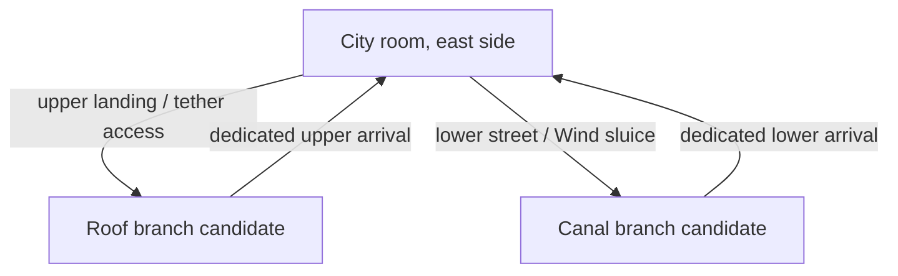

# TR-02 — same-wall multilevel exit proposal (not implemented)

Status: separate creator/PM topology approval required. TR-02 adds no exits, cells, platforms or map state. Example future study: eastern side of a city room with an upper roof passage and a lower street/canal culvert. Distinct exits must have distinct IDs, planes, destinations and reciprocal landing fixtures; they cannot share the current room-index-only transition assumption.

| Item | Upper candidate | Lower candidate |
|---|---|---|
| Vertical band | roof elevation, e.g. y500 | street elevation, e.g. y1120 |
| Approach | ledges and reversible tether route | dry culvert walkway |
| Policy | automatic directional threshold | automatic threshold if open; element gate checked independently |
| Return | distinct supported landing at roof band | distinct supported dry landing at street band |
| Map | upper exit port and lock icon | lower exit port and independent Wind state |
| Failure | lower rest shelves reconnect | recover on dry walkway |

Coordinates are illustrative, not inserted into any existing graph. PM must select real source/destination IDs, authorize geometry, specify acquisition order and verify no upper/lower ability bypass. Map must show both port heights, even if branches lead to the same neighbor room. Validate max-momentum crossing, ceiling/wall clearance, camera limits, save/respawn fixtures and return navigation for each port. A future authoritative edge ID should replace ambiguous target-only lookup where multiple connections share a room pair. Do not fake those new branches through TR-02 presentation.
