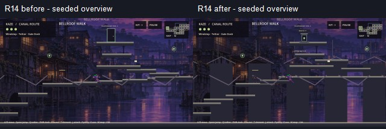
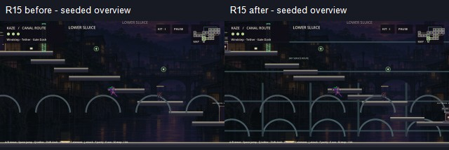
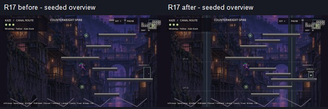
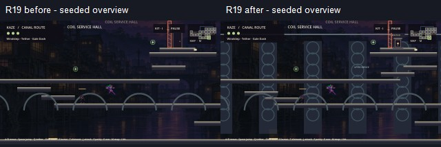

# LD-01-0061 — prioritized world audit

Assignment reference: `8a23d0f:docs/agent_assignments/LD01_ALPHA061_ASSIGNMENT.md` (read in full). Starting integration tip: `34be30436996284ec2f783269c40269d321ed427`. Prior LD-01 handoff and DEV-06 world implementation/QA reports reviewed. Source confirms 21 rooms and 29 undirected edges (12 original chain, two original returns, 15 expansion links). Room count and graph stay unchanged.

## Priority and before/after

| Priority | Room | Before-state gap | Implemented refinement |
|---|---|---|---|
| P0 | R14 Bellroof Walk | Shelf order crosses to east then back west; few local route landmarks | Additional horizontal roof-rest sequence and high return shelves; distant roofs/masts and Upper Watch label |
| P0 | R17 Counterweight Spire | Tall generated zigzag with repeated city art; climb height hard to interpret | Authored intermediate rest positions, distant cable shafts and lift level marks; all three portals retained |
| P1 | R15 Lower Sluice | Underground tint on outdoor city background; sparse descent staging | Authored stepped descent, retaining arches/depth bands, dry service route landmark |
| P1 | R19 Coil Service Hall | Wide floor-level crossing followed by sparse upper service path | More deliberate lower service rests, upper route platforms, coil bays and conduit landmark |

Global exit presentation changes from an 80×136 outline to a 48×65 inset within a 64×84 housing, with lintel, landing base, center symbol and E cue. Interaction radii/destination/feet coordinates remain unchanged. Route plaques are added beside portals in the four refined rooms. Decoration is drawn behind gameplay platforms, never added as collision. Original rooms 0–7 geometry is unchanged as required by baseline guidance.

## Verified complete connection inventory

All destinations below are source-defined reciprocal connections; forward story locks may differ on original chain edges.

| ID | Room | Connected room IDs | Change scope |
|---|---|---|---|
| 0 | CANAL HAVEN | 1, 13 | exit presentation only |
| 1 | LANTERN MARKET | 0, 2 | exit presentation only |
| 2 | FLOODED CISTERN | 1, 3, 15 | exit presentation only |
| 3 | ECHO SHRINE | 2, 4, 9 | exit presentation only |
| 4 | BROKEN SPAN | 3, 5 | exit presentation only |
| 5 | ASCENT TOWER | 4, 6, 17 | exit presentation only |
| 6 | TIDE WARDEN | 5, 7 | exit presentation only |
| 7 | RELAY ARCHIVE | 6, 8 | exit presentation only |
| 8 | RELAY UNDERCROFT | 7, 9, 12, 16, 18 | exit presentation only |
| 9 | SIGNAL TERRACE | 3, 8, 10, 14 | exit presentation only |
| 10 | SKYWORKS APPROACH | 9, 11 | exit presentation only |
| 11 | STORM FOUNDRY | 10, 12, 19 | exit presentation only |
| 12 | KEEPER RELAY | 8, 11 | exit presentation only |
| 13 | MOORING LOFT | 0, 14, 20 | exit presentation only |
| 14 | BELLROOF WALK | 9, 13, 17 | layout + identity + exit presentation |
| 15 | LOWER SLUICE | 2, 16 | layout + identity + exit presentation |
| 16 | ROOT SHRINE | 8, 15, 18 | exit presentation only |
| 17 | COUNTERWEIGHT SPIRE | 5, 14, 20 | layout + identity + exit presentation |
| 18 | PUMP GALLERY | 8, 16, 19 | exit presentation only |
| 19 | COIL SERVICE HALL | 11, 18, 20 | layout + identity + exit presentation |
| 20 | RELAY JUNCTION | 13, 17, 19 | exit presentation only |

## Critical path / elemental protection

Market guard → Windstep/Wind → Echo Shrine Tether → Tower Dash/Electric (Fire in Span) → Tide Warden → Electric Archive seal and restoration → three named annex sigils (one Fire-sealed) → Wind intake → Electric Foundry relay → Storm Keeper → Keeper attunement. Expansion links do not write story flags or enter R12 directly. Wind Sluice, Wind Spire shutter, Electric Pump isolator and Fire Coil service seal remain at their existing positions; both-direction edge prerequisites remain unchanged. Junction return still requires its switch and regional flags. Known original finite-height barriers are protected semantically at their rewards/portals; this task does not enclose them or claim every physical barrier is impassable.

Checkpoints remain Haven R0, Echo Shrine R3, Archive R7, Undercroft R8, Foundry R11, attuned Keeper R12 and Root Shrine R16; exact checkpoint coordinates and saved flags are unchanged. Ordinary original entrances use west/east interaction points; expansion edges use explicit reciprocal arrival positions/pads. Recovery floors remain solid in all eight expansion rooms; no bottomless pits were added. Vents in R15/R18/R19 and their four-second telegraph/damage cycles are unchanged. Guards, lane bounds, anchors and collectible coordinates are unchanged. Existing side routes, Stride pickup, lore and return loops remain, rather than adding mechanics or regions.

## Remaining gaps / Art requests

- All environments still reuse the outdoor district image. Request native subterranean retaining-wall/pipe backgrounds, vertical shaft silhouettes, rooftop skyline layers and coil service backgrounds from Art; current geometry drawing is a composition prototype.
- New service ledges remain one-way. Wall-jump opportunity is available on existing perimeter walls; no new solid wall-jump surfaces were added because they need grapple obstruction and collision approval.
- Existing anchor art is still placeholder; supported anchor assets remain an Art dependency. Anchor positions/algorithm were preserved.
- Pacing, scenic empty space and route comprehension need continuous creator testing at gameplay zoom. Four representative rooms improved; other rooms require future approved passes.
- Existing finite-height seals and old fall-loss rooms remain broader follow-up work; state guards/gate tests still pass.

## Before/after visual evidence

Seeded overviews at identical camera settings, native OpenGL/Godot 4.6.1; not fresh-save progression or 60 FPS evidence.

Reproduce using `tests/capture_dev06.gd` on baseline and feature checkouts with separate disposable APPDATA, passing the output directory as the first argument after `--`. It saves all eight expansion rooms and atlas. Full-resolution local captures are in ignored build/ld061-before and build/ld061-after. The first attempted invocation incorrectly passed --test as that first argument and failed PNG saving; it was corrected, and the successful capture logs contain only the known certificate-store diagnostic. No failed capture is presented as evidence.
