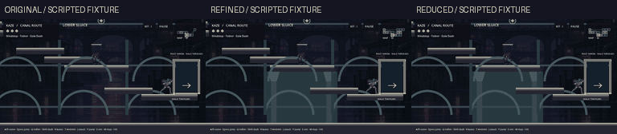
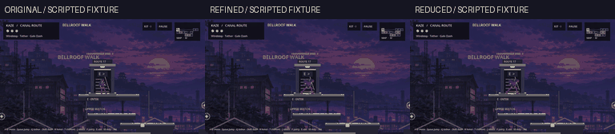
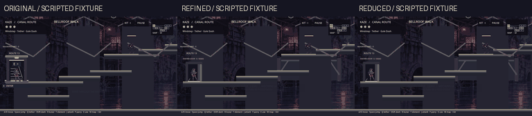

# TR-03 Lane A review guide

Start with [PM return](../agent_handoffs/TR03_LANE_A_PM_REPORT.md), [endpoint matrix](ENDPOINT_MATRIX.md), [structural plan](STRUCTURAL_DRESSING_PLAN.md) and [QA](QA_RESULTS.md). This is an isolated staging prototype on TR-02, not a final animation/art integration.

## Comparison evidence

Source captures1280×720 / zoom1.0; GIFs downsampled, seeded scripted fixtures. Original TR-02, refined staging and reduced-motion are shown side by side. Finished walk/rear/stair sprites are not present or creatively approved. No final art from PR24/25 is imported.

## CLI / handoff contract

- Default: scoped refined staging on grounded R15↔R16 and R14↔R17. Existing wind-fold is unchanged.
- --tr03-original: exact TR-02 presentation, no new structure/proxy.
- --tr03-reduced-motion: static pose/fade and inherited reduced camera treatment.
- --tr03-plain: plain comparison without staging or inherited rotating stair accent.
- --tr03-depth-demo: adds depth presentation only to existing R14↔R13 endpoints; no graph/gate change.
- --tr03-no-dressing: disables the two visual support pilots only.
- --tr03-save=/absolute/path: explicit isolated save override; ordinary launch default save identity unchanged.

Adapter scripts/embodied_transitions.gd snapshots actual approach before the existing freeze. The authoritative arrived callback follows room build and exact feet placement. It does not reschedule the0.65-second clock or infer direction from room-local y. Reused clips keep their own scales/baselines; new320×724/pivot(160,600) pack is only a future art contract. Proxy owns texture/offset/frame/position; player sprite visibility is restored on completion/cancel/death/pause/rebuild. Pausing cancels visuals, not pending travel. No proxy coordinates feed velocity/collision/saves.

Gated demo's lateral movement is approach alignment only; inward displacement stays on its explicit(0,-1) screen-depth axis. Width contraction is an unmistakably labelled quarter-pose placeholder, not finished rear-facing art. Stair treads show three local contacts, not full inter-room stair simulation. Explicit ascent R14→R17 and reciprocal descent are provisional presentation orientation for creator review, not derived world altitude.

Lane B technical refs: PR25 head85025b1c and PR24 head ecaee806. Keep final production art separate until creator approval. New clips must implement distinct6-frame walk/up/down,4-turn/3-enter/3-leave/2-profile pack with fixed root; never retrofit the proposed new pivot onto the old sheets. Audio integration and global controller support are separate lanes.
