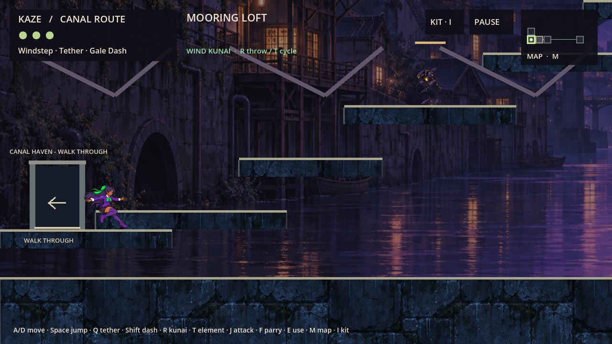
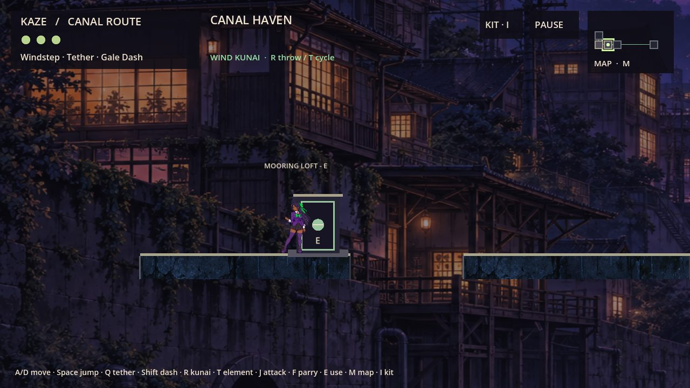
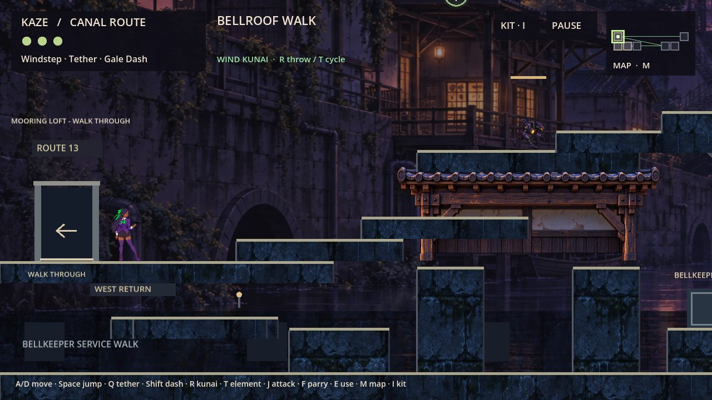
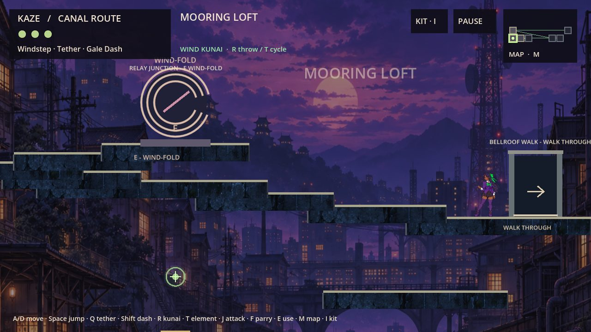
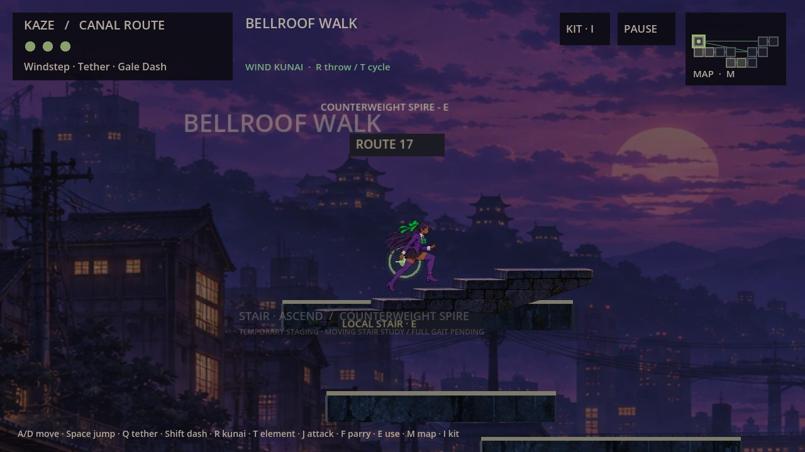
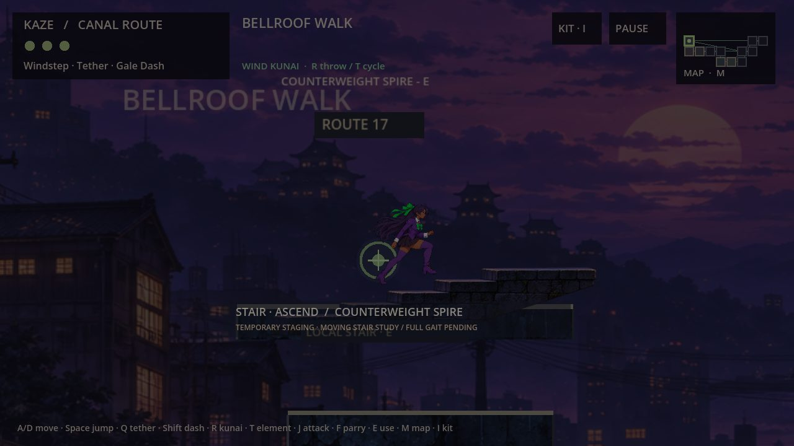
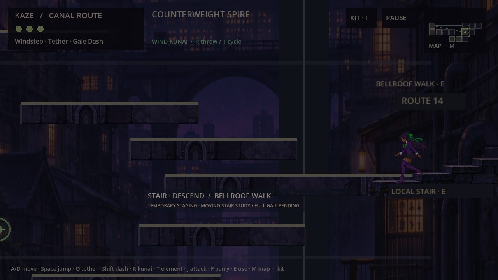
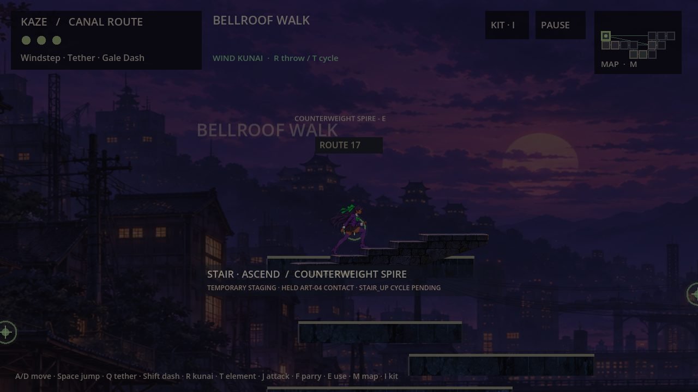

# TR-05 playable transition review

[Draft PR39](https://github.com/cappy2yappy/momentum-fractured/pull/39), stacked on PR37. No merge.

Runtime/presentation source: `f168339a6fa6b02f16958ce250636dbe47d4a783`. Geometry base: `b950373efb5c4621d7da7e0be1506db048e3043a`. Earlier TR05/PR33 checkpoint61607f4 is preserved, not substituted for this build.

Start with [QA matrix](QA_MATRIX.md), [Level/Art/Build handoff](COORDINATION.md), [endpoint inventory](evidence/endpoint-matrix.json) and [complete PM return](../agent_handoffs/TR05_PM_REPORT.md). Hosted build/download pointers are finalized in the PM return after successful upload.

## Three demonstrations

1. **Canal automatic:** `Play-Canal-Automatic.cmd`, hold A. R13→R0 crosses without E.
2. **Bidirectional doorway:** `Play-Door-East.cmd`, hold D. Release, stop, wait a beat, then hold A to return R14→R13. `Play-Door-West.cmd` starts the reverse side.
3. **Cinematic stairs:** `Play-Stair-Cinematic.cmd`, E. `Play-Stair-Descending.cmd` reverses it; `Play-Stair-Reduced-Motion.cmd` keeps the camera/pose still. F6 toggles reduced motion live.

Demo launchers reset only their own supplied fixture profiles. `Play-Fresh.cmd` keeps an unseeded separate campaign. Direct EXE uses the historical ordinary save identity; use launchers for controlled review. Windows only in this delivery; Mac-native proof belongs to the Build Shogun follow-up.

## Native gameplay captures

These are real1280×720 Godot Windows rendered fixtures with physical-key events, not human playtest footage. JPEGs are review derivatives of native PNG captures. Approved Kaze art is unchanged; camera zoom temporarily reaches1.55x for stairs.

The staircase shows spatial character movement using distinct approved held ascent/descent keys. It is explicitly a moving prototype: no completed leg/foot gait, outward animation or full ART05 cycle is claimed. Walk crossings retain a labelled existing-pose fallback; running reuses the approved run strip.
